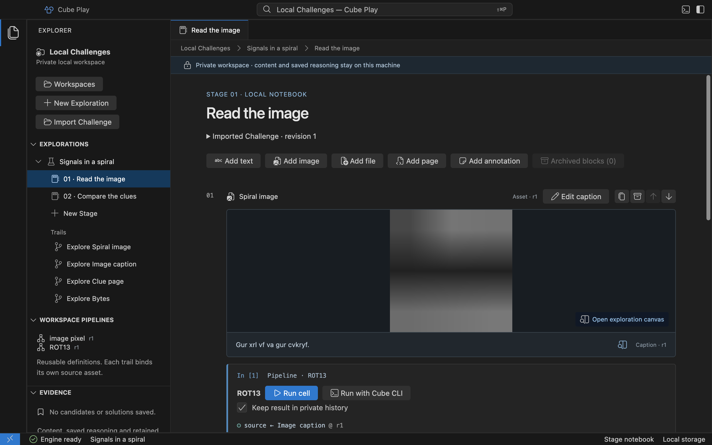

# Import a local Challenge

Open a Workspace and choose **Import Challenge** in the Explorer. Select a
Cube Play Challenge JSON package. Play creates a separate Exploration, opens its
first Stage and presents its ordered content in the editable notebook.

Try the [example package](assets/challenge-example.json): save the linked JSON
file, then select it in the native file chooser. It contains two Stages, an image
with its caption, an inert Page, an annotation and a binary file. The image and
caption remain in one Block and have separate Asset identities.

1. Inspect the image or open its exploration canvas.
2. Choose **Run cell** on its caption to apply **ROT13**. The output is
   `The key is in the pixels.`
3. Edit the caption or add your own reasoning. Reopening the Workspace preserves
   those changes and any retained Run results.

Actual Electron source preview. [Open full-size screenshot](assets/desktop/challenge-import.png).

Importing does not run operations, execute HTML or follow external links. An
invalid or oversized package creates no partial Exploration. The source file is
read without modification. Canceling the chooser leaves your notebook intact.

Each import creates independent local IDs. Import the same package again to
investigate it separately; notes and progress do not merge. Moving the source
file does not change its package identity. Expand **Imported Challenge** to
inspect its package revision and SHA-256. Any supplied remote identity is a claim
from the package, not authenticated participation or official verification.

You can also assemble clues with **New Exploration**, **New Stage** and the
[notebook content controls](notebook.md). A package is not required for local work.
For package authors, see the [package format and limits](reference/challenge-package.md).

Online cloning, progressive unlocking, submissions and official evaluation belong
to the separate Cloud project. Private Candidates/Solutions remain a separate
local delivery; imported content and successful Runs do not imply a saved solution.
