# Organize Explorations and Trails

An Exploration is an independent investigation inside a Workspace. It owns its
Stages, Blocks, Assets, reasoning and Trail history. Use **New Exploration** to
start another investigation, and select its Stages in the Explorer. Its content
and selected Stage remain separate when you switch or reopen the Workspace.

## Open an Asset canvas

Click a text Asset, image, caption, file or Page in a Stage notebook. Play opens a **Trail
canvas** tab for that Asset in the same Exploration. A caption's canvas shows its
exact bound Asset revision, selected reusable Pipeline and accepted Run history.
The image's canvas supports inspection, zoom and a [typed first-pixel Run](visual-lab.md#read-the-first-pixel). Page canvases show inert source text. A file's canvas shows an inert
text/hex preview, byte count and SHA-256 digest. The preview and full digest are
read-only fields: focus them with the keyboard to select and copy their values. Results stay with the cell or
canvas that produced them.

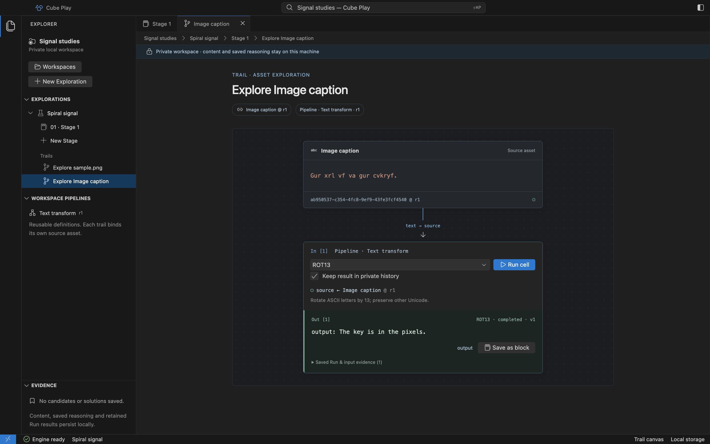

Opening the caption creates its own canvas tab inside the same Exploration. [Open full size](assets/desktop/caption-canvas.png).

## Save a hypothesis

Choose **Edit Trail** in a text, caption, Page or image canvas. Write a hypothesis and
choose **Save Trail**. The hypothesis belongs to that Trail and survives restart;
another Exploration keeps its own reasoning and progress.

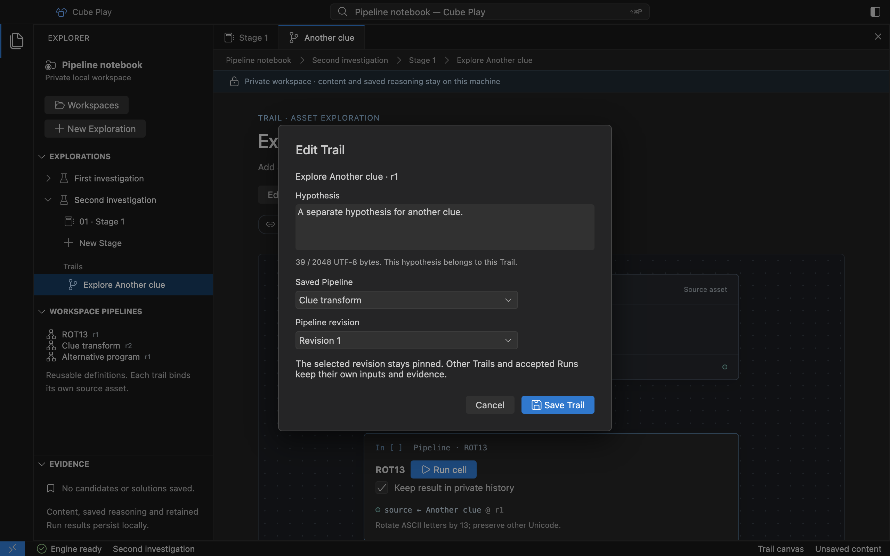

Choose a saved revision and keep this Trail's hypothesis. [Open full size](assets/desktop/trail-editor.png).

## Save and reuse a Pipeline

**New Pipeline** starts with one initial operation for the primary Asset and fresh
input bindings. **Fork Pipeline** copies a chosen definition with its origin
recorded; **Edit Pipeline** revises the existing definition.

Choose **New Pipeline** to name a reusable graph. Select an operation by its Core
name, review its typed inputs and parameters and choose **Create Pipeline**.
The Trail selects the saved revision. Choose **Run cell** to execute it against
this Trail's bound Asset.

**Edit Pipeline** opens the current head for editing. Choose **Add node** to add
an operation, select a node in the canvas and bind each input to the source, a
compatible named output or an explicit literal. For example, two connected ROT13
nodes transform `Gur xrl.` into `The key.` and back into `Gur xrl.`. Move a node
by dragging it or focusing it and pressing an arrow key. Choose **Use as output**
to select the result and its required dependencies. Rust rejects cycles and
incompatible ports before saving.

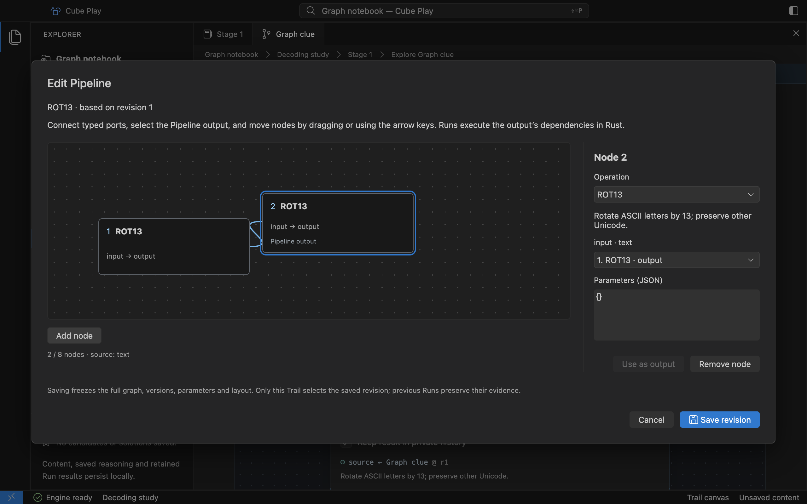

Connect named ports and save the complete revision. [Open full size](assets/desktop/pipeline-graph-editor.png).

**Save revision** freezes a new configuration and selects it only for the current Trail. An identical
configuration keeps the same revision. Other Trails stay pinned to their chosen
revisions; previous Runs keep their evidence and results.

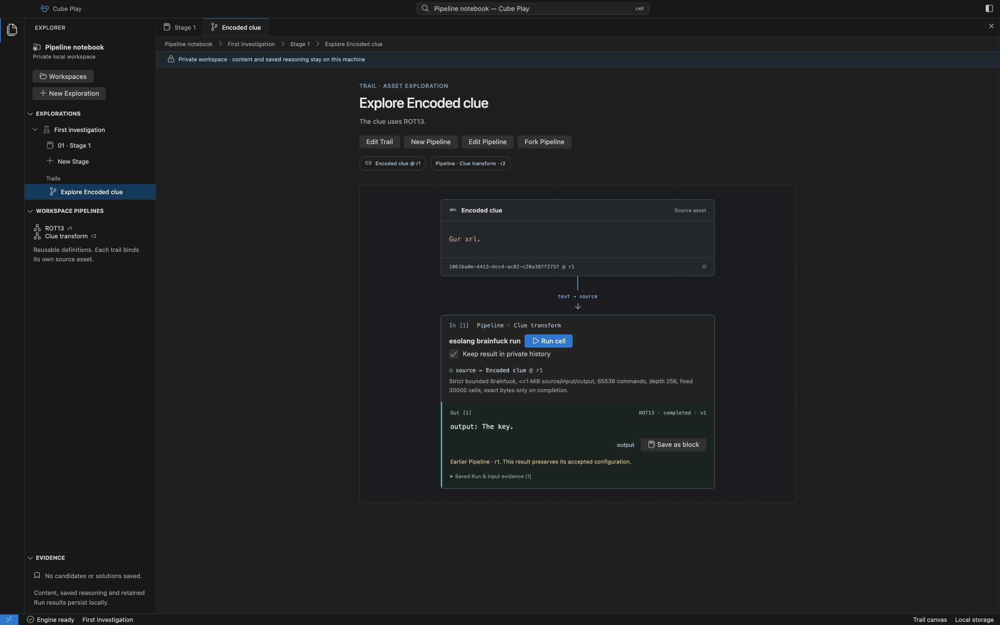

The working revision and historical Run keep separate configurations. [Open full size](assets/desktop/pipeline-revision.png).

The worker executes up to two ready nodes concurrently within one Run's resource limits.
Expand **Saved Run & input evidence** to inspect each actual node attempt and
retained intermediate output. Disconnected nodes do not execute. Saving an output
as a Block refers to the selected output node's actual attempt.

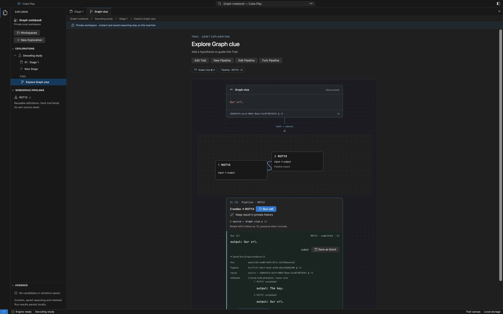

Inspect the actual attempts beside the result. [Open full size](assets/desktop/pipeline-graph-run.png).

To reuse a definition in another Exploration, open its Asset canvas, choose
**Edit Trail**, then choose **Saved Pipeline** and **Pipeline revision**. Keep a
separate hypothesis and save. Each Trail supplies its own Asset and history.

Choose **No Pipeline** in **Edit Trail** to inspect the Asset without an active
operation. Saved Run history remains visible in the notebook and canvas, including
after restarting the app.

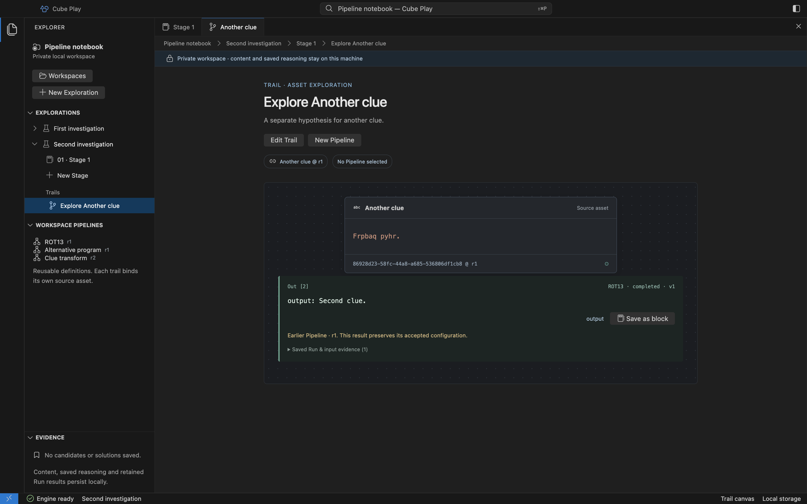

The accepted result remains inspectable independently of the working configuration. [Open full size](assets/desktop/unbound-history.png).

Choose **Fork Pipeline** to create an independently versioned alternative from
the selected revision. The fork records its source; edits to either definition
do not change the other. Use **Edit Pipeline** after the fork to change its
operation or parameters. [Pipeline reference](reference/desktop-pipelines.md)
describes exact commands, revisions and limits.

## Use an image and its caption in one Pipeline

Keep the image and caption together in their notebook figure. Open the image's
canvas, choose **New Pipeline**, name it, and add a text input named `caption`.
Under **Trail inputs**, select the figure's caption Asset. Add a second node and
choose **ROT13**; its text input can now use `caption`. Save the Pipeline.

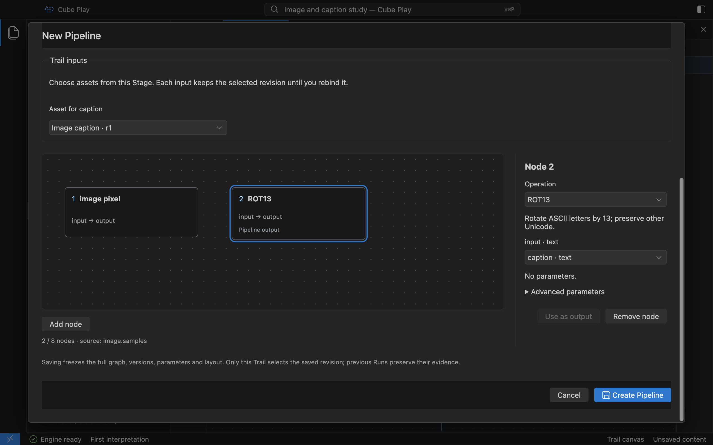

The reusable graph declares input names; the Trail supplies the Assets. [Open full size](assets/desktop/pipeline-inputs-editor.png).

**Run cell** executes the default output. To inspect the image branch, select its
pixel node and choose **Run node**. The Run records that target and only executes
its dependencies. Both actions preserve the same Pipeline revision and show their
results in the Trail's history.

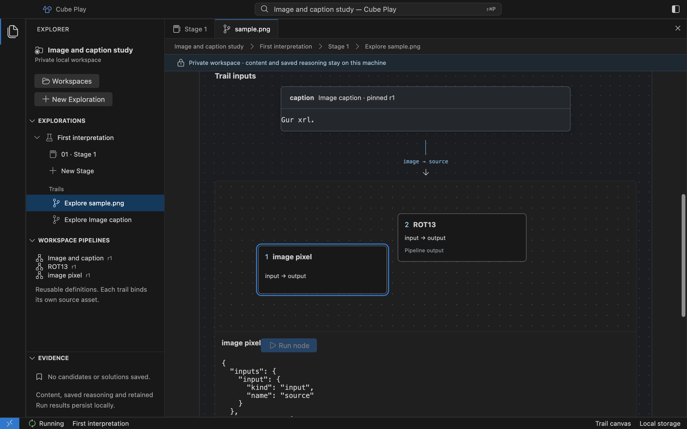

Inspect and execute each branch from the canvas. [Open full size](assets/desktop/pipeline-inputs-canvas.png).

Additional inputs stay pinned when their Assets are edited. **Edit Trail** shows
the selected revision and offers the current revision explicitly. Selecting it
and saving advances this Trail without changing earlier Runs. A second
Exploration can choose the same saved Pipeline and bind its own caption.

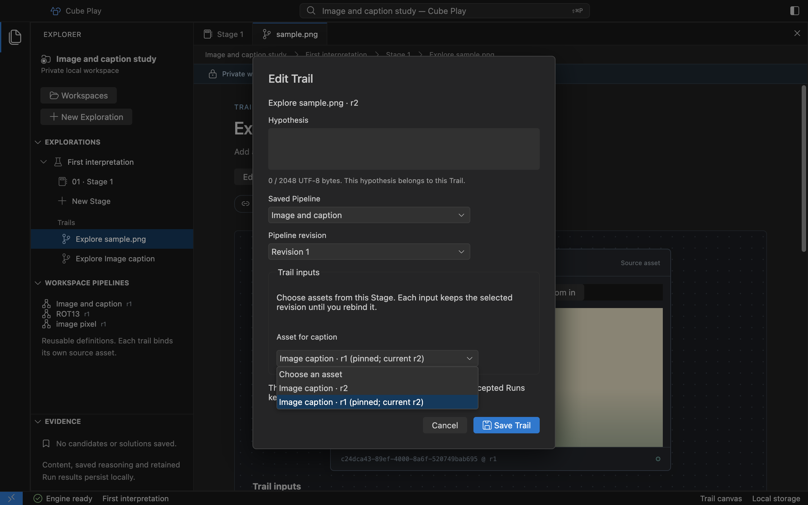

Rebind an input when you want to use the edited content. [Open full size](assets/desktop/pipeline-inputs-binding.png).

## Combine image and caption results

Use the [sample PNG](../tests/fixtures/composition.png) with the caption `xrl.`.
Download the PNG from its repository file page, then add it as an image with that
caption. This fixture stores the ASCII bytes `Gur` in its three RGB channels.
Reading pixels uses those byte values; it does not recognize drawn letters.

Open the image canvas, create a Pipeline named **Joined clues**, and add the text
input `caption` bound to the figure's caption Asset. Keep the first **image pixel**
node at `(0, 0)` and build these connections:

| Node | Operation | Input |
| --- | --- | --- |
| 1 | image pixel | Image `source` |
| 2 | Decode UTF-8 | Node 1's byte output |
| 3 | ROT13 | Node 2's text output |
| 4 | ROT13 | `caption` |
| 5 | Concatenate text | `left`: Node 3; `right`: Node 4 |

Set **Separator** to one space, keep Node 5 as the output and save. The left
branch produces `The`; the right produces `key.`. **Run cell** returns **The key.**
with five actual node attempts. Image and caption branches can overlap; the
join waits for both inputs. All nodes share the Run's resource limits.

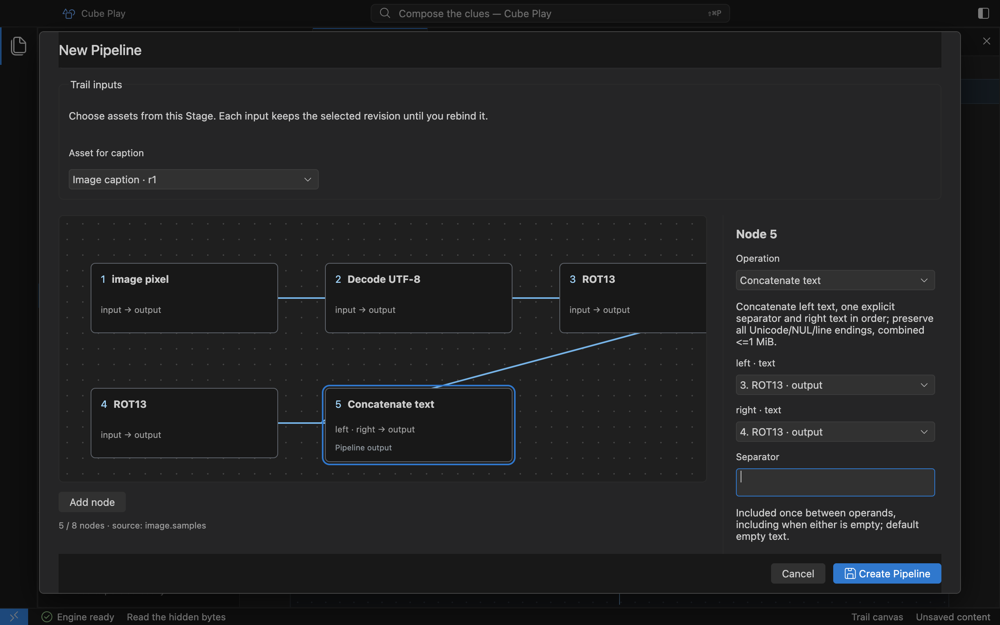

Choose each operand and the separator explicitly. [Open full size](assets/desktop/composition-editor.png).

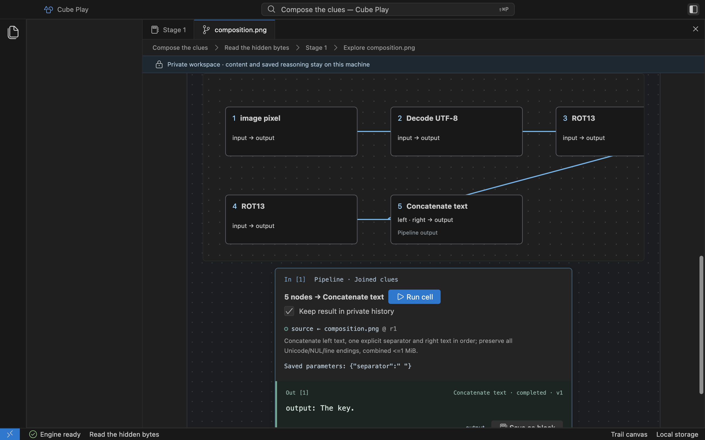

The result retains its source revisions and intermediate attempts. [Open full size](assets/desktop/composition-canvas.png).

**Save output as block** adds the final text to the Stage with its exact Run,
attempt and output-port origin. Changing the working Pipeline does not rewrite
that result or its earlier graph.

For binary composition, **Concatenate bytes** keeps arbitrary bytes in left/right
order. Byte operands can come from a compatible output or an explicit
**Bytes (Base64)** literal. **Encode UTF-8** and **Decode UTF-8** cross the text/byte
boundary explicitly. Invalid UTF-8 fails without replacement; downstream nodes do
not start, and completed producer evidence remains available.

## Combine dimensions and a numeric caption

Add the [sample PNG](../tests/fixtures/composition.png) with the caption `7`.
It is one pixel wide and one pixel high. Open its canvas, create a Pipeline,
and declare a text input named `caption` bound to that figure's caption Asset.
Build this graph:

| Node | Operation | Input and parameters |
| --- | --- | --- |
| 1 | Image dimensions | Image `source` |
| 2 | Select field | Node 1; **Field path** `/dimensions` |
| 3 | Maximum | Node 2's JSON array |
| 4 | Parse integer | `caption` |
| 5 | Add | `left`: Node 3; `right`: Node 4 |

Select Node 5 as output and save. **Run cell** returns **8**: `max([1,1]) + 7`.
This notation explains the graph; Play does not evaluate expressions. Each of
its five nodes has a retained attempt and intermediate value.

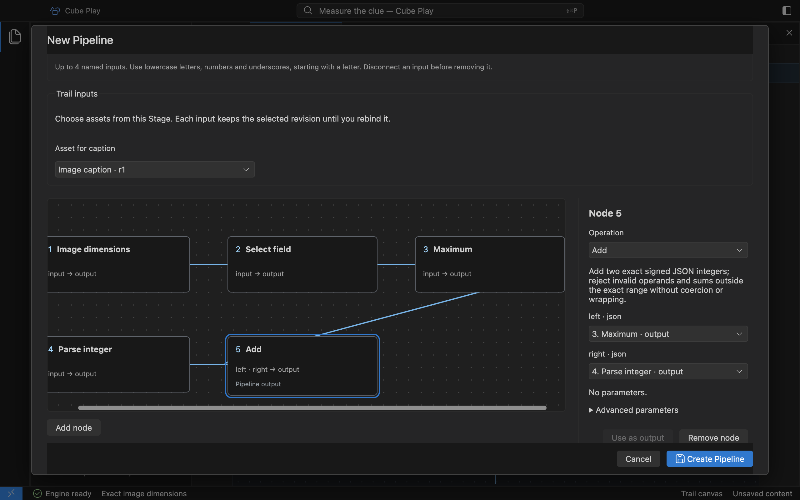

Use **Field path** and the named input controls to connect the graph. [Open full size](assets/desktop/numeric-editor.png).

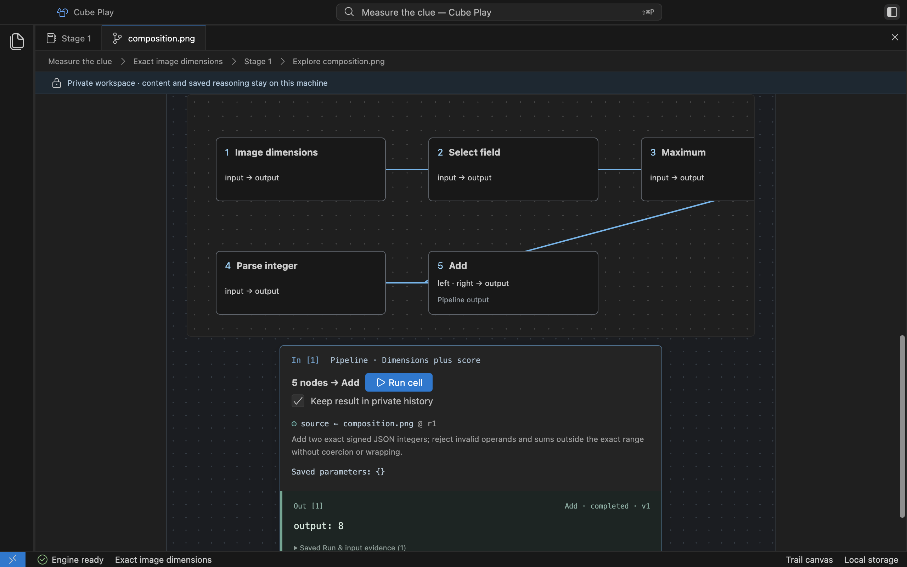

Inspect numeric results as numbers beside their producing graph. [Open full size](assets/desktop/numeric-canvas.png).

Operation parameters have labeled controls. **Advanced parameters** exposes the
complete saved JSON when needed. Integer literals reject fractions and unsafe
integers before saving, preserving an invalid draft when switching nodes. Input
schemas are checked again by the engine before a consumer executes.

For JSON text, connect **Parse JSON → Select field → Use text value** before a
text operation such as **ROT13**. A field path selects the original JSON type.
An existing `null` is retained; a missing field fails explicitly. **Use text
value** rejects `null`, objects and numbers instead of silently converting them.
JSON objects containing a `base64` key remain JSON, rather than being displayed
as byte outputs.

Integer composition is exact within ±9,007,199,254,740,991. **Parse integer**
requires canonical decimal text; Maximum and Add reject fractional/mixed values.
A missing field, incompatible consumer or overflowing sum stops downstream work
and keeps completed producer evidence. See [Core's field and integer reference](https://github.com/cubearc/cube/blob/main/docs/reference/structured-composition.md)
for pointer escapes, empty values and exact bounds.

## Follow an edited Asset

[Edit text or a caption](notebook.md#edit-text-and-captions) in its notebook to
append an Asset revision. Its existing Trail and open canvas show that saved
revision without creating a second Asset or canvas identity. Earlier Runs stay
bound to their original inputs; the result marks an earlier input until another
Run is accepted for the saved content.

## Work while another Run executes

Run another cell or switch to a different Exploration to continue investigating.
Each cell keeps its own queued/running state, result and Cancel control. Up to two
Explorations execute concurrently; another Run in the same Exploration waits its
turn. Cancelling a queued cell creates no execution attempt and leaves other
cells active. When the queue is full, wait or cancel a Run before trying again.
See [queue limits and recovery](reference/desktop-runs.md#concurrent-runs-and-queue).

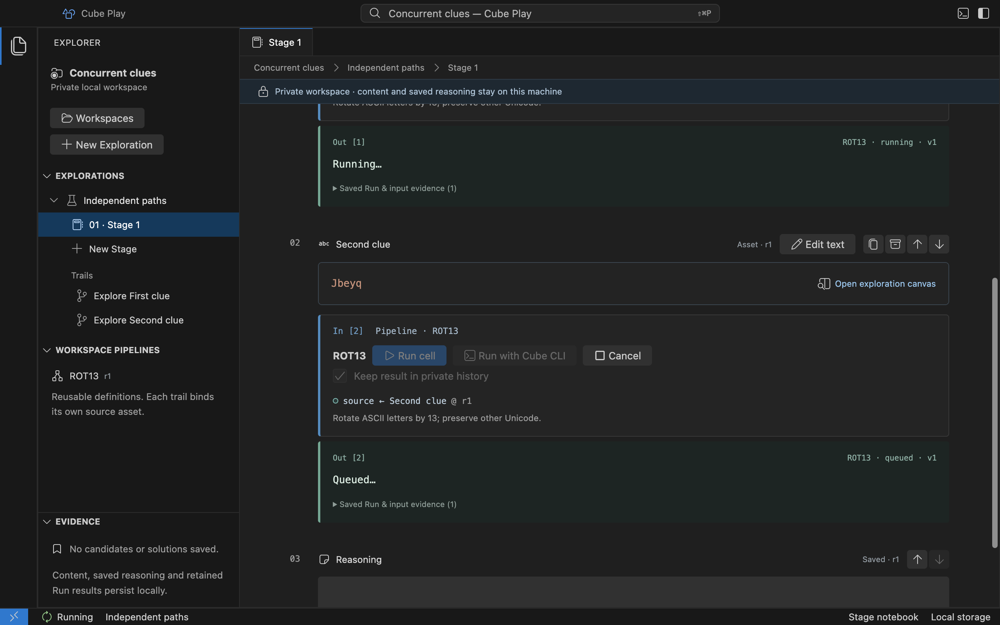

The second cell waits within the same Exploration. Its Cancel control affects only
that Run. [Open full size](assets/desktop/run-queue.png).

## Preserve evidence

Choose **Run cell** to create a PipelineRun, rather than replacing an earlier
execution. [Notebook controls](notebook.md) explain retention and saved reasoning.
Closing a canvas does not cancel its active Run while the app is alive; quitting
the app ends the private engine session. Canvas tabs remain in memory. Saved hypotheses, Pipeline selections and accepted
Runs persist. [Saved state](persistence.md)
explains restart and interruption behavior.

General structured-result promotion and external contextual CLI
attachment remain unfinished. Their implementation status lives in the [milestone](https://github.com/cubearc/play/milestone/3).
## Read an image in a spiral

Open the image's Trail canvas and choose **New Pipeline**. Select **image pixels**,
then set **Traversal** to **Spiral clockwise** or **Spiral counterclockwise** and
choose the starting corner. Leave **Use channels** off to keep native sample order;
turn it on for an explicit ordered JSON list such as `["gray"]`. **Use region**
accepts `[x,y,width,height]`. Coordinates begin at the image's top-left corner.

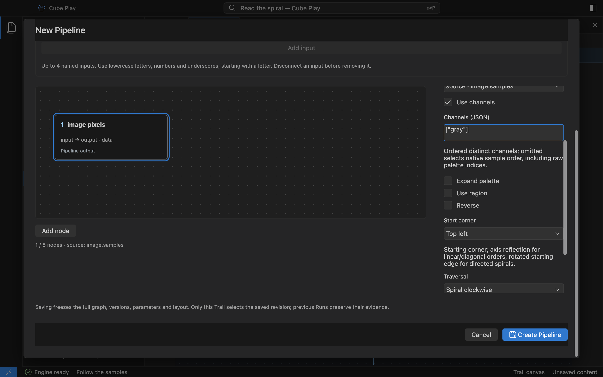

[Open the full-size parameter editor](assets/desktop/spiral-editor.png).

Add **Decode UTF-8** and bind its byte input to **image pixels · data**. The other
port, **output**, retains region, channels and traversal metadata. Add **ROT13**
when the decoded text requires that transformation, save the Pipeline and choose
**Run cell**. This reads encoded sample bytes; it does not recognize drawn letters.

The example's grayscale rows are `Gur`, `!! ` and `lrx`. Clockwise traversal yields
`Gur xrl!!`; UTF-8 decoding and ROT13 produce `The key!!`. The screenshot also reverses
the text twice to demonstrate an unrelated Core registration in the same graph.
Every actual node attempt and both export ports remain inspectable after restart.

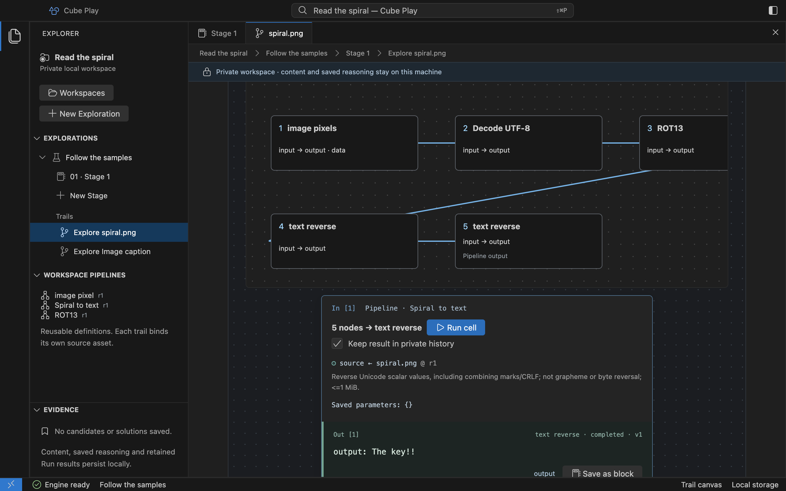

[Open the full-size completed graph](assets/desktop/spiral-canvas.png).

The native catalog discovers registered Core executors, their typed ports and
parameter choices. An operation with supported capabilities needs no per-operation
Play implementation. [Execution capabilities](reference/desktop-pipelines.md#execution-capabilities)
explains which registrations the current native host can admit.

Use [native Run reference](reference/desktop-runs.md) for implemented execution
semantics and [the domain contract](reference/desktop-domain.md) for full ownership.

## Run a cell with Cube CLI

Open the Asset's Trail canvas and choose **Run with Cube CLI** beside **Run cell**.
Play starts its bundled Cube executable with the selected Pipeline revision and
output node. The engine records the same input revisions, executes the same graph
and displays the result inline. **Saved Run & input evidence → Started by** shows
**Cube CLI** or **Desktop** for each accepted Run. Both remain available after
reopening the Workspace.

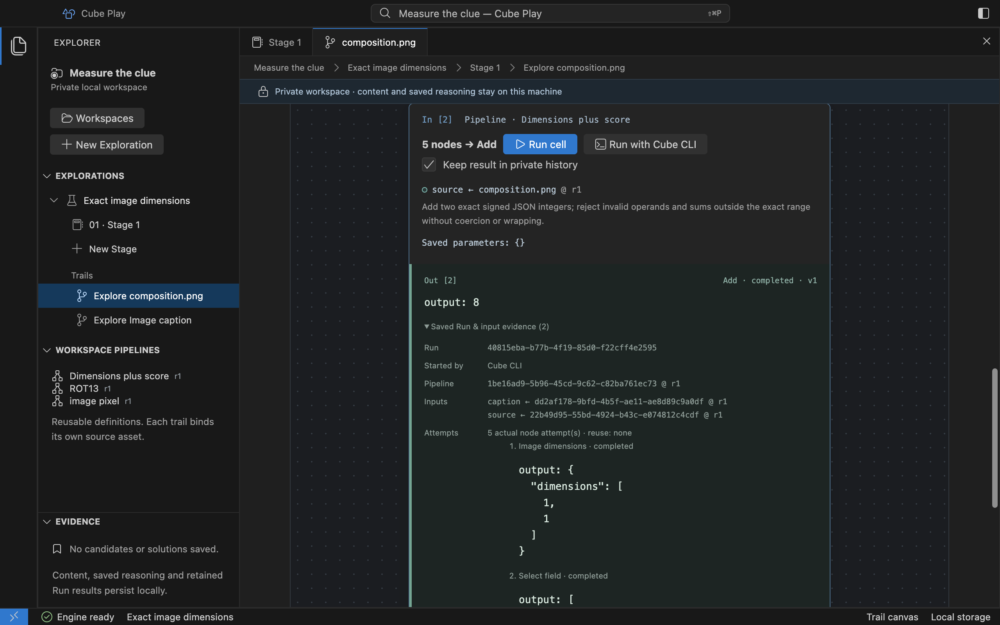

The same saved graph runs through either entry point. [Open full size](assets/desktop/context-cli.png).

This action uses the real CLI through an attached private session. It does not
open an interactive terminal. Use the [Cube terminal](terminal.md) for a macOS or Linux
PTY session. External terminal attachment is
separate work; the [attached command reference](reference/desktop-runtime.md#attached-cube-cli-commands)
describes the supported commands and limits.
