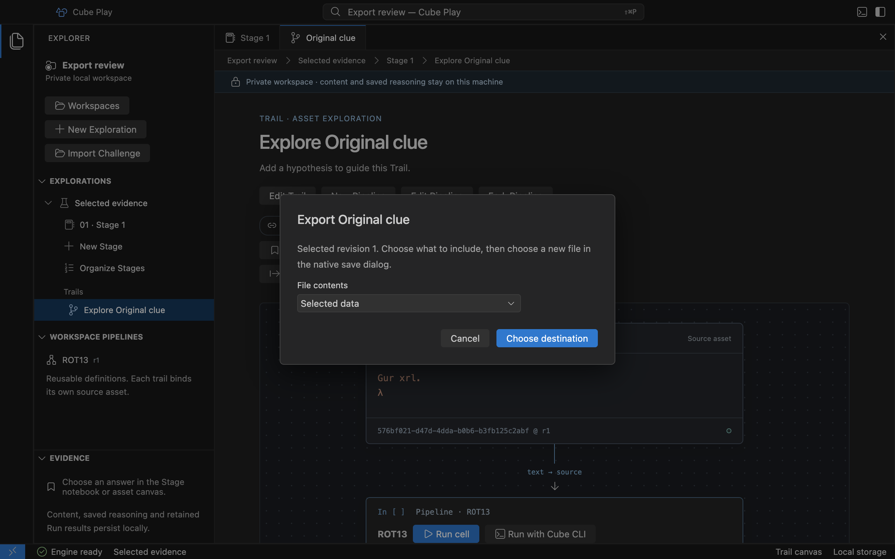

# Export selected evidence

Open an Asset canvas and choose **Export _title_**, or choose **Export _port_**
next to a retained completed Run output. Select **Selected data** for exact text,
bytes or a JSON value; images export as PNG. Choose **Data and evidence references
(JSON)** to include the source identity, exact revision or Run port, provenance
and Base64 content with a SHA-256 digest.

Choose **Choose destination**, then select a new filename in the native save
dialog. Existing files and application/private storage are protected. If a name
already exists, choose another. Cancelling leaves the notebook and its history
unchanged. Exporting never executes a Pipeline.

Captured from the actual Mac preview using disposable example content.
[Open full size](assets/desktop/export-evidence.png).

## Export a walkthrough

In **Solutions**, choose the saved Solution and its revision, then **Export
walkthrough**. The JSON document includes that revision’s title, explanation,
selected evidence payload, saved Note snapshots and contributing Pipeline
parameters, literal inputs and references. These can contain private values,
including keys.
A later explanation or unselected private Note is not included. Inspect the
selection before handing the file to someone else.

References to upstream content remain references; this is not a Workspace backup
or a guarantee of replay. Missing evidence appears as an explicit gap. Export does
not submit an answer or change its **Private · Unverified** state.

The current export limit is 1 MiB for the complete document. Large or unavailable
selections fail without changing saved evidence. Files contain private content
only after the user chooses an export and its destination.
