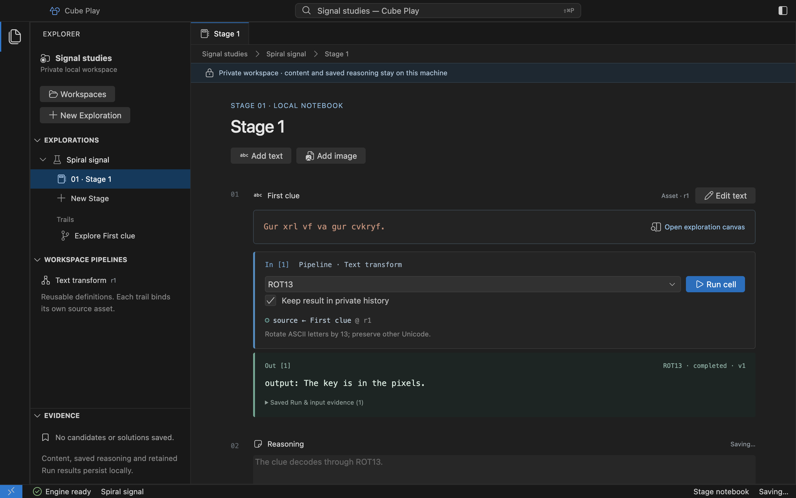

# Decode a clue in your first notebook

[Open the Electron preview](installation.md) on macOS. This example uses a text
Asset and the real Core ROT13 operation; it does not require a Challenge or a file.

1. On the welcome screen, enter a Workspace name, such as **Signal studies**, and
   choose **Create workspace**.
2. Choose **New Exploration**, enter **Spiral signal** and choose **Create**.
   Its first local Stage opens as a notebook.
3. Choose **Add text**. Give the Block a title and enter
   `Gur xrl vf va gur cvkryf.` as its text, then choose **Add text**.
4. Keep **ROT13** selected and **Keep result in private history** checked.
   Choose **Run cell**. The result beside that cell is `The key is in the pixels.`
5. Click the text Asset to open its **Trail canvas**. The canvas shows its bound
   input, selected Pipeline and Run result. Expand **Saved Run & input evidence**
   to inspect the accepted configuration and source revision.
6. Write an observation in **Stage note**, then choose **Save reasoning** or press
   Cmd+S. Quit and reopen the app: the notebook, saved reasoning and retained
   result reopen in the same Exploration.

The macOS source preview after decoding the clue; the result stays beside its cell. [Open full size](assets/desktop/first-notebook.png).

Use **New Exploration** to keep a second investigation independent. Use
**New Stage** to add a local part to the selected Exploration. Notes and results
from the first Exploration do not become content in the second.

For a visual clue, [add an image with its caption](workspace.md). The caption
appears with its image and can feed ROT13 directly; there is no need to copy it
into a separate text cell. [Notebook controls](notebook.md) cover retention,
reasoning and keyboard shortcuts. Continue with
[editing text and captions](notebook.md#edit-text-and-captions) to change a clue
while preserving the result you just obtained.
