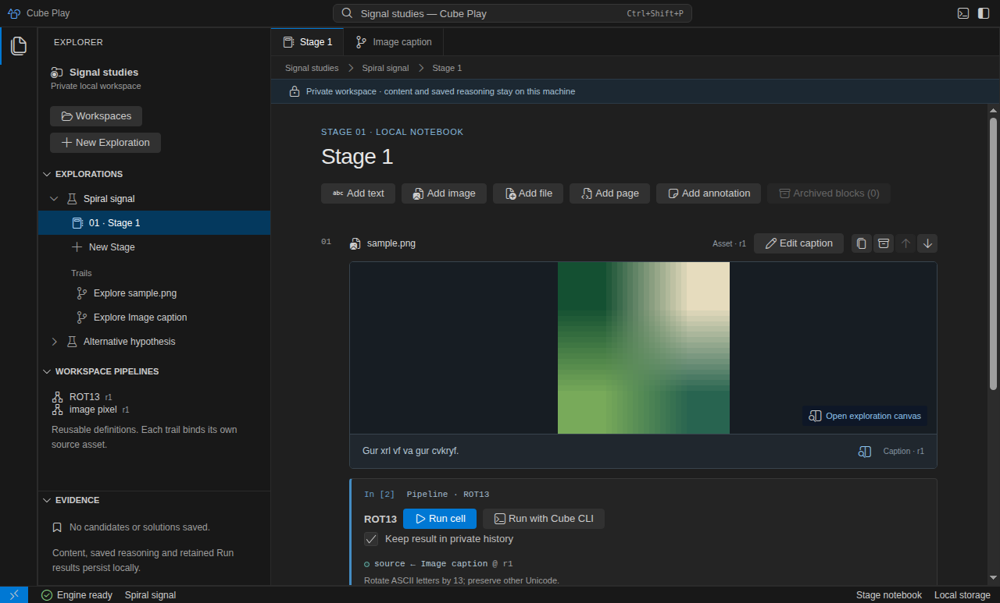

# Run the Electron source preview

<a id="install-cube-play-from-source"></a>

Build the current desktop preview from trusted Cube and Play checkouts side by
side. Operations run on macOS and Linux x64/ARM64. macOS uses a locally signed
App Sandbox helper; Linux requires enabled Landlock ABI 3 and seccomp filtering.
The Windows preview refuses execution with `native_policy_unavailable`. Missing
enforcement has no fallback. The interactive terminal uses the same supported native hosts.
There is no release-supported signed installer or automatic updater yet.

## Prerequisites

- The Rust toolchain in `rust-toolchain.toml`, installed through rustup.
- Node.js from `frontend/.nvmrc` and npm; the package minimum is Node 24.15.
- Cube 0.18.0 sources at `../cube`, matching Play's dependency and the reviewed
  Core revision in [CI](../.github/workflows/ci.yml).
- On macOS, Xcode Command Line Tools, including the local `codesign` tool.
- On Linux, an active graphical session and Electron/Chromium runtime libraries.
  Ubuntu 24.04 x64/ARM64 is tested. Chromium must have a usable OS sandbox;
  never launch with `--no-sandbox`. See [Linux validation](development.md#validate-linux-electron)
  for the tested sandbox-helper setup.

Ensure `cargo` and `rustc` resolve to rustup, and Node matches `frontend/.nvmrc`;
a separate system Rust/Node installation may take precedence in your PATH.

Docker, Compose and WSL are not application prerequisites. Installation downloads
npm dependencies, Electron and Rust dependencies as needed.

## Build and open

From the Play repository root:

```sh
npm ci --prefix frontend
npm run desktop:build --prefix frontend
npm run desktop:proof --prefix frontend
```

The build compiles the renderer, preload and Rust engine, and prepares the local
native helper. The last command opens **Cube Play**. Create a Workspace in the
welcome screen; an empty checkout does not contain a sample investigation.
Continue with [your first notebook](getting-started.md).



The actual Linux Electron notebook, captured by the native UI test with disposable
example data. [Open full size](assets/desktop/linux-notebook.png).

## Build a standalone preview bundle

After the source build, create a bundle for the current host and architecture:

```sh
npm run desktop:package --prefix frontend
```

The command places **Cube Play** under `frontend/desktop-packages/`. macOS produces
an application bundle; Linux produces a directory containing `cube-play`. Copy the
whole bundle/directory together. The package contains Electron, the Rust engine,
Cube CLI and the verified native helpers. Running it does not require Cargo, npm,
Docker or the source checkout. Linux still needs the OS libraries and Chromium
sandbox support described above; missing enforcement remains an error.

On Linux, keep the `cube-play-linux-*` directory in a path without spaces. The
setuid Chromium sandbox helper [truncates executable paths containing spaces](https://github.com/electron/electron/issues/21309);
the package builder rejects such an output path. Keep the sandbox enabled and
choose a suitable location, such as `/opt/cube-play`.

A populated output is preserved. Choose another output directory as a trailing
argument when creating another preview. `package-proof.json` inside the app records
the source revision/dirty state, exact component versions and native binary digests.
Only compiled runtime files are staged; build tooling, test probes and private
Workspace data are excluded. Private data stays in the normal app profile.

This is a local qualification bundle with no publisher signing or notarization.
It does not establish a release installer, Windows worker support or verified
updates. Save work before quitting or replacing an application bundle.

Use **Quit** to end the app. Closing a window on macOS can leave the app and its
engine alive; closing a canvas does not cancel its Run. Save reasoning before
quitting. [Resume saved work](persistence.md) explains what survives restart.

These commands run a development build from the checkout, not an installed
release. Local helper signing does not establish publisher signing or
notarization. See [native execution](reference/desktop-runtime.md) for exact
platform boundaries, or [Development](development.md) to validate the build.
