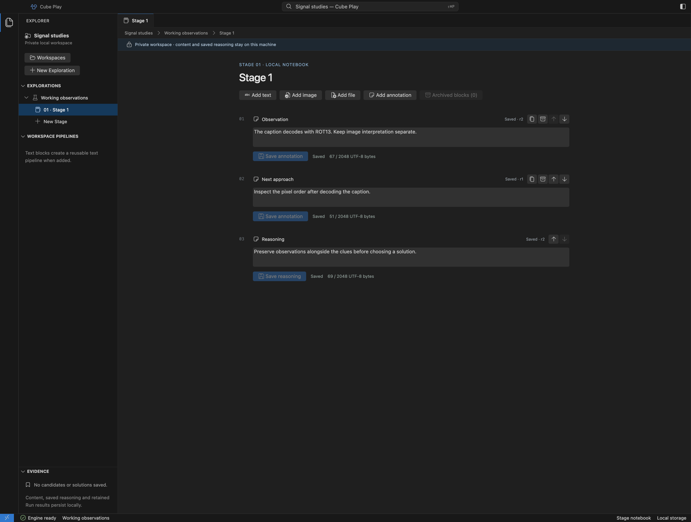
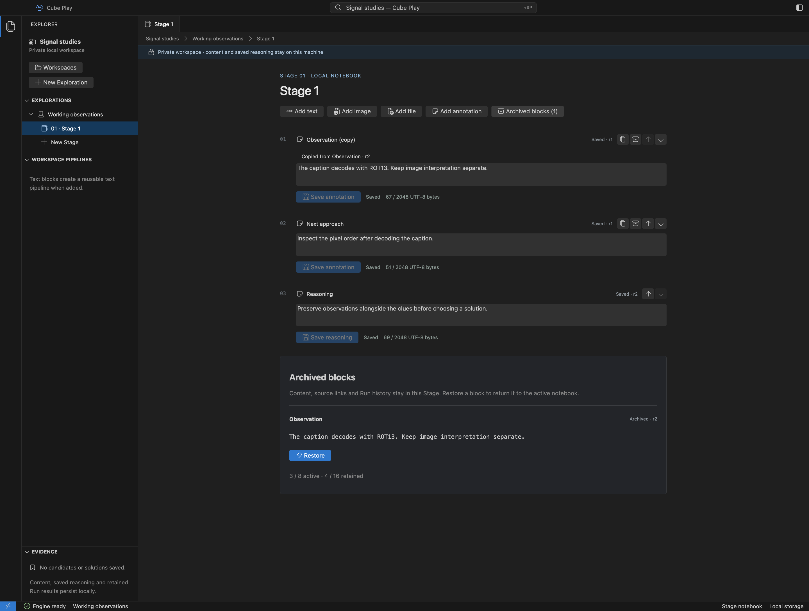
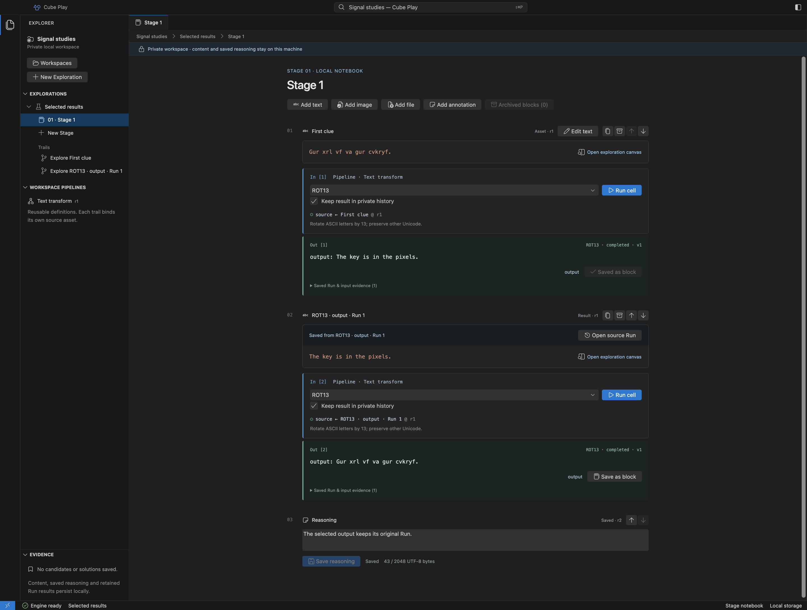
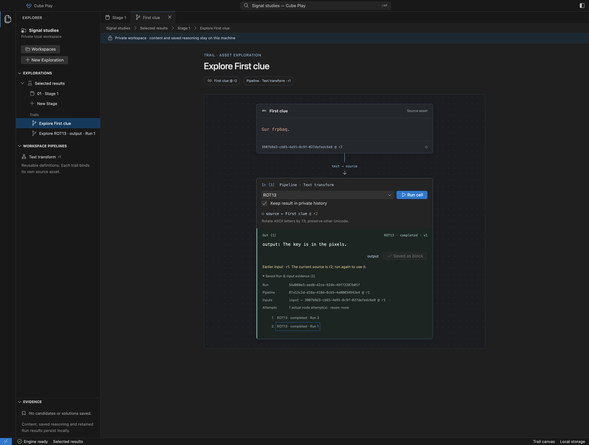
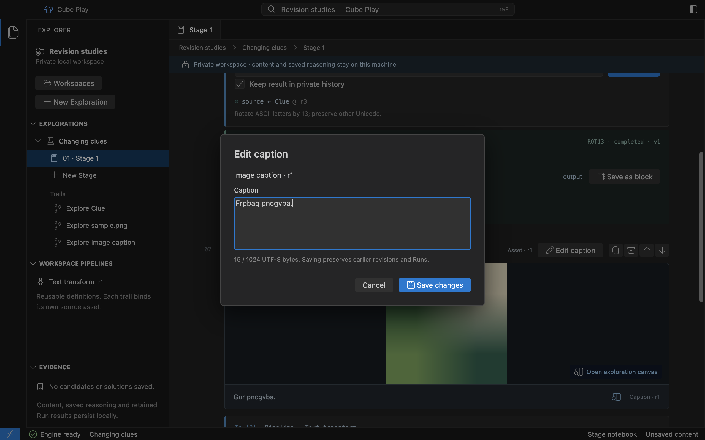
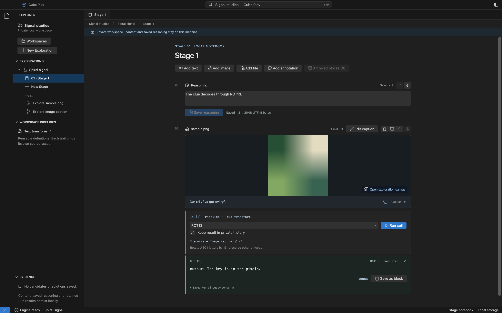
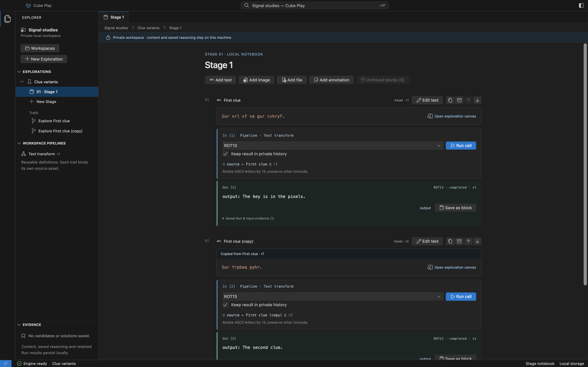
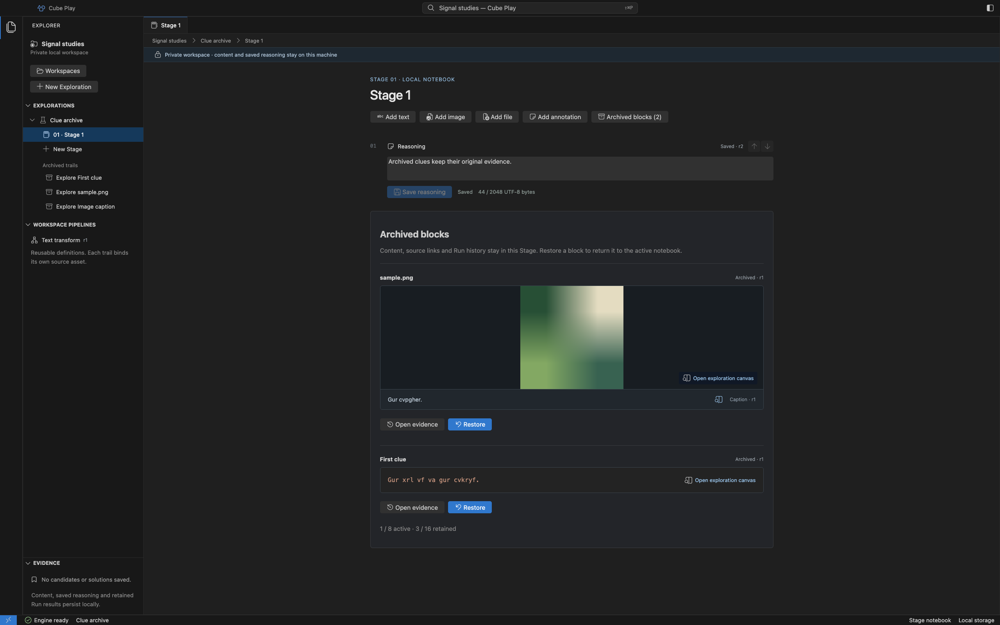
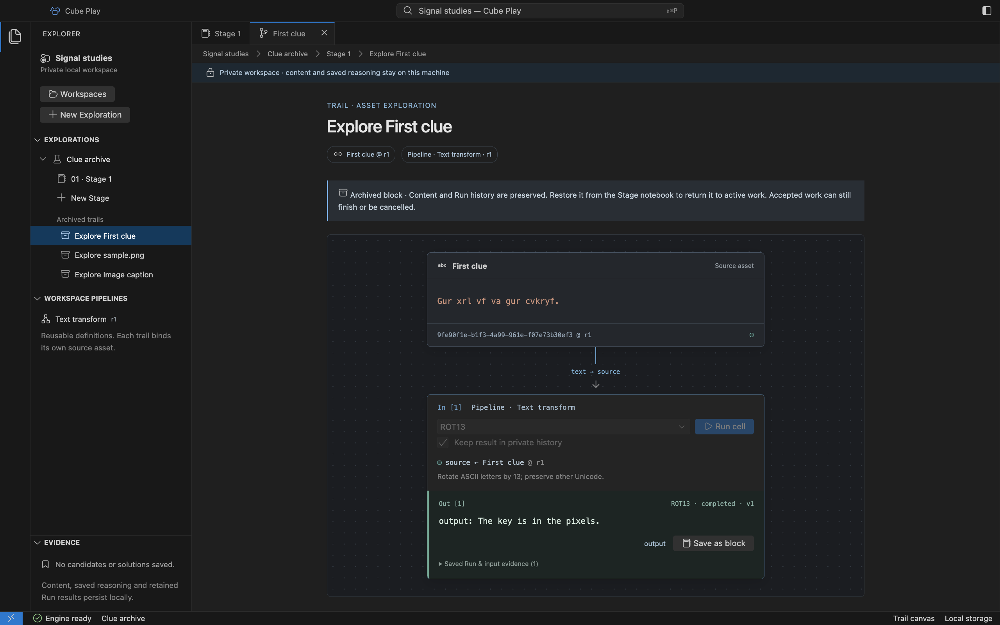

# Work in a Stage notebook

Each Exploration has its own local Stages. A Stage combines ordered content
Blocks, annotations, cell results and saved reasoning. Choose **New Stage** in the Explorer
to create another local part without importing a Challenge.

Use [Add text, Add image or Add file](workspace.md) to add clues. An image caption stays in
the image's figure, with its own input Asset identity. Clicking an Asset opens a
Trail canvas in the same Exploration; [Explorations and Trails](explorations.md)
explains the relationship.

## Add and save annotations

Choose **Add annotation**, give it a title and enter your observation. The title
is set when created; the text stays editable beside the clues. Annotations use
plain text, including any markup, up to 2048 UTF-8 bytes per saved revision.
They do not become operation inputs or open a Trail canvas.

Choose **Save annotation** or press Cmd/Ctrl+S inside that annotation. Only that
Note is saved: other annotation and reasoning drafts stay independent. Wait for
its **Saved** status. **Discard draft** restores that Note's latest saved text.
If another revision was saved first, Play keeps your draft and reports a
conflict. Copy anything you want to keep, then discard the draft to review the
latest saved revision before editing again.

Each annotation has its own save status and revision. [Open full size](assets/desktop/annotation-notebook.png).

Use the heading arrows to reorder an annotation. The copy icon creates a new
Note immediately after it, with independent content and a label identifying the
source revision. Saving either Note never edits the other. Copy and archive
require saving or discarding that annotation's draft first. Saved Note revisions
are preserved; this preview does not include a revision browser.

The archive icon moves the annotation to **Archived blocks** as read-only text.
**Restore** brings back the original Note and Block identities, saved revision
and copy origin. Annotations have no **Open evidence** or Run action. The unique
**Reasoning** cell remains active and cannot be copied or archived.

An archived annotation retains its saved content. [Open full size](assets/desktop/archived-annotation.png).

Drafts stay in the current app session when changing Stage or Exploration.
Closing or quitting with unsaved Notes offers **Keep editing** or **Discard
draft**. Save before quitting; drafts do not survive a crash. Cmd/Ctrl+Enter
inside an annotation or reasoning never runs another cell.

## Run a text cell

Select **ROT13** or the Brainfuck adapter (`esolang brainfuck run`) and choose
**Run cell** on macOS. The operation
runs through Core in a supervised native worker. Progress, cancellation and the
result appear beside that cell, with the same Run visible in its Trail canvas.
There is no shared Output panel. The preview does not execute a multistep graph.

**Keep result in private history** chooses whether the accepted Run stores its
output. When checked, the result survives restart. When cleared, the saved Run
records **output was not retained**; the output cannot be recovered from history.
Brainfuck output is labeled as Base64 bytes, without an implicit text conversion.

Expand **Saved Run & input evidence** to inspect an earlier Run or load older
history. Accepted Runs pin the input revision and Pipeline/Core configuration;
choosing another operation does not rewrite previous evidence. See
[native PipelineRuns](reference/desktop-runs.md) for states and exact retention.

## Save a result as a Block

Run a text cell with **Keep result in private history** checked, then choose
**Save as block** beside its output. Play adds the selected value before trailing
reasoning and focuses the result Block. Your reasoning draft stays in place.
This saves evidence without running another operation.

**Saved from ROT13 · output · Run 1** identifies the operation, named port and
exact Run. Choose **Open source Run** to inspect its original input and attempt.
If you later edit the source or run it again, the saved Block still contains
the chosen output. You can also select an earlier Run in **Saved Run & input
evidence** and save that result instead of the latest one.

The selected output has its own Asset and Trail while preserving its source evidence. [Open full size](assets/desktop/result-notebook.png).

A saved text result can feed **Run cell** in its own Block or Trail canvas. That
creates a new Run using the exact result text; it does not invent a reused
attempt. Byte outputs remain File Assets with exact bytes and an inert preview,
without becoming runnable text. File operations remain unavailable in this preview.

The source link opens the chosen Run after a later edit and execution. [Open full size](assets/desktop/result-source-run.png).

Saved results are read-only. To edit a text alternative, duplicate the result
Block, then use **Edit text** on the copy. Reorder, archive and restore result
Blocks using the same controls as other content. Their source links and earlier
Runs survive reopening, even if the original clue is archived.

One Block represents each Run/attempt/output selection. **Saved as block** means
it already exists in this Stage, including Archived blocks; saving again does
not create another copy or restore archived content. Use **Duplicate** for a
distinct alternative. Runs without retained output, or that did not complete,
cannot create a result Block. Stage and storage limits still apply. If another
action changed the notebook, review the refreshed Stage and save again; your
reasoning draft is kept.

## Edit text and captions

Choose **Edit text** in a text Block or **Edit caption** on an image that has a
caption. Change the content, then choose **Save changes** or Cmd/Ctrl+S. The editor
shows its starting revision and UTF-8 byte count; the 1024-byte limit also applies
to edits. **Cancel** discards this edit draft.

Saving keeps the Block and Asset identities and appends a revision. The image and
caption stay in one figure, and editing the caption leaves image bytes unchanged.
Its existing Trail uses the saved revision for the next Run. A Run already in
progress continues with its original input.

An older result remains visible with **Earlier input · r1** when the current
source is r2. Choose **Run cell** to execute the saved content; earlier Runs remain
in history. Saving text does not execute it, and Cmd/Ctrl+Enter inside the editor
does not start a background Run. Cmd/Ctrl+S saves the editor without saving a
separate reasoning draft.

The caption editor in the macOS source preview. Saving preserves earlier input
revisions and Run evidence. [Open full size](assets/desktop/caption-editor.png).

If another edit was saved first, the editor keeps your draft and reports a
conflict. Copy any text you want to keep, then **Cancel** and reopen the editor to
review the latest saved revision. It never silently overwrites that content.
Unsaved text/caption edits trigger the same **Keep editing** / **Discard draft**
choice as reasoning when closing or quitting; drafts are not crash-recovery data.

## Reorder the notebook

Use the up and down arrows in a Block's heading to move it one position. The
image, caption and inline result move together. **Reasoning** is also an ordered
Block; move it between clues or place it first.

Tab to a move button and press Enter to use the keyboard. After a successful
move, focus follows the Block and its position is announced. Cmd/Ctrl+Enter in a
text or caption Block runs that Block's selected operation. In any Note, that
shortcut does not run another Block.

Moves save immediately and survive reopening. They preserve Asset identities,
saved revisions, Trails, earlier Runs and unsaved Note drafts. If another action
changed the order first, Play shows the latest order and keeps your draft; try
the move again. Reordering is visual organization, not Pipeline scheduling.

The ordered notebook in the macOS source preview. Image and caption remain one
Block. [Open full size](assets/desktop/ordered-notebook.png).

New content is placed before reasoning when reasoning is last. If you have moved
reasoning elsewhere, new content is appended without moving the existing Blocks.

## Duplicate a clue

Choose the copy icon in a text, image or file Block's heading. Tab to
**Duplicate First clue** (or the Block's title) and press Enter to use the
keyboard. The saved content is copied immediately after the source, and focus
follows it. An image and its caption stay together.
File copies preserve the exact bytes and have independent Asset and Trail IDs;
they remain inert file previews.

The copy has a distinct title, such as **First clue (copy)** or
**First clue (copy 2)**. **Copied from First clue · r1** identifies its original
input revision. Use **Edit text** or **Edit caption** on the copy, then choose
**Run cell** to investigate an alternative. The original content and Runs stay
intact. Copies start without Runs; duplicating a Block never runs an operation.

Two clue variants in the macOS source preview. The copy keeps its origin while
using its own saved input. [Open full size](assets/desktop/duplicated-blocks.png).

Copies keep their own Assets and Trails, so editing either version does not edit
the other. Their content starts at r1 even when copied from a later revision.
The source label stays pinned to that original revision. Saved results and
reasoning are not copied into the new Trail.

If the source or notebook changed first, Play shows the latest content and keeps
your reasoning draft. Review it, then duplicate again. Unsaved text in an editor
must be saved or cancelled before copying. Copies count toward the Stage's eight
active Blocks, sixteen retained Blocks and stored-content budget. The button is
disabled when a Block ceiling is reached.
**Reasoning** remains one Note Block per Stage and has no duplicate action.

## Archive and restore a Block

Choose the archive icon in a text, image or file Block's heading. The Block leaves the
active notebook, while its Assets, source links, Trails and Run history stay in
the Stage. Images and captions are archived together. Saved reasoning and any
reasoning draft stay in place; the unique **Reasoning** Block cannot be archived.

Choose **Archived blocks** to inspect the saved content. **Open evidence** opens
its Trail canvas, where earlier Runs remain available. The canvas identifies the
Block as archived and disables new executions. Existing accepted work keeps its
original inputs and supervision; it can finish or be cancelled from that canvas.

The Stage keeps its archived content and source identities. [Open full size](assets/desktop/archived-blocks.png).

Earlier Run evidence stays readable while the Block is archived. [Open full size](assets/desktop/archived-canvas.png).

Choose **Restore** to return a Block with the same IDs, revisions, bindings and
history. Tab to **Restore First clue** and press Enter to use the keyboard. It is
placed before trailing reasoning, or at the end if reasoning was moved earlier.
Focus follows the restored Block. You can edit, copy and run it again.

Archiving frees an active slot, but keeps stored data. A Stage allows eight active
Blocks and sixteen retained Blocks in total, including reasoning and archives.
At eight active Blocks, archive another before restoring one. At sixteen retained
Blocks, restore existing content or create another Stage. Historical content and
Runs still count toward the stored-byte budget. There is no permanent Block delete
action in this preview.

If content or order changed first, Play shows the latest state and keeps your
reasoning draft. Review it before trying again. Archiving does not save a separate
editor draft. Quit/reopen restores the archive and its evidence.

## Save reasoning

Write in **Stage note**, then choose **Save reasoning** or Cmd/Ctrl+S. Wait for
**Saved** before leaving the Stage. Saving appends an immutable reasoning revision;
a conflict preserves the draft rather than silently replacing stored content.
Closing or quitting with unsaved reasoning offers **Keep editing** or
**Discard draft**. Unsaved drafts are not crash-recovery records.

## Keyboard controls

| Action | macOS | Windows/Linux UI |
| --- | --- | --- |
| Toggle Explorer | Cmd+B | Ctrl+B |
| Open command palette | Cmd+Shift+P | Ctrl+Shift+P |
| Run active text cell | Cmd+Enter | Ctrl+Enter |
| Save editor or focused Note | Cmd+S | Ctrl+S |

Windows/Linux worker execution is refused by the current native policy, even
though the UI has keyboard bindings. [Installation](installation.md) states the
platform scope. Image replacement, permanent Block deletion and result export
are not available in this preview.
