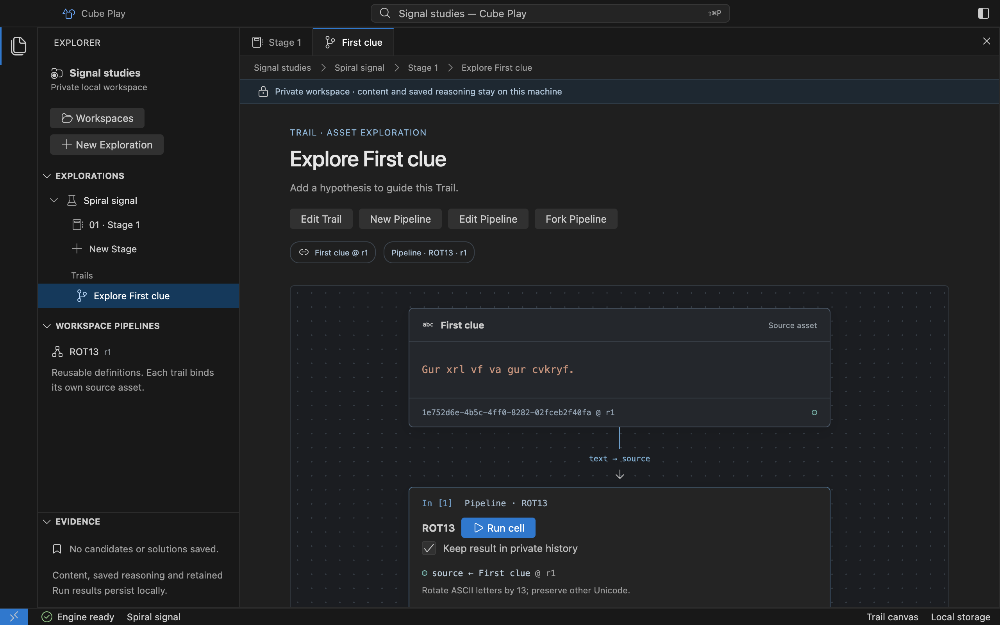

# Resume saved work

Quit and reopen the Electron preview to restore the last successfully opened
Workspace, Exploration and Stage. The Rust engine saves text/image/file/Page and annotation Blocks, Asset/Note
identities and revisions, the complete Block order, saved reasoning, Trails, versioned Pipeline definitions
and accepted graph Runs in private local storage.

Retained outputs reopen beside their cells and in Trail history. A Run accepted
without output retention reopens with an explicit gap. Operation-selection
drafts and open canvas tabs are not persisted. Save each annotation or reasoning Note and wait for
**Saved** before switching. Save text/caption editors with **Save changes**; their
revisions persist under the original Asset IDs. Unsaved drafts do not survive a
crash. Editing never rewrites an earlier Run's input revision or result.
Duplicated Blocks reopen with their own content, Assets, Trails and saved Runs.
Their source revision labels remain pinned even after the original is edited.
Saved result Blocks retain their exact Run/attempt/port origin and typed value.
Their source link opens the chosen Run after later edits or executions. A text
result's independent Runs also reopen without changing that original evidence.
Annotation Notes reopen with independent saved revisions and pinned copy origins.
Their drafts are kept only in the current app session.
Archived Blocks and their Run history also survive reopening. Use **Archived
blocks** in the Stage notebook to inspect or restore them. Restoring preserves
their identities and revisions; archiving never discards stored content.

After reopening, the notebook can show an earlier Run with its stored input and attempt evidence. [Open full size](assets/desktop/run-history.png).

## Interrupted execution

Closing a canvas or window leaves supervision active while the app stays alive.
Explicit **Quit** closes the engine session and cancels its active worker. After
an engine crash, reopening a recognized store marks unfinished accepted Runs
**interrupted**. Completed evidence is not rewritten. See
[Run state and recovery](reference/desktop-runs.md#state-and-recovery).

## Storage and recovery

Private data lives under `CubeArc/Play` in Electron's per-user application-data
directory, outside imported source files. Do not move databases into a source
folder or delete an owner lock to force access. Another live owner produces
`workspace_busy`; an unsupported or altered store is refused without reset.

An incompatible store remains intact. Use a supporting app version or create a
separate Workspace. There is no old product-store importer or automatic reset.
The current baseline and unsupported-store refusal are described in
[native storage](reference/desktop-storage.md), together with exact paths, quotas
and lock ownership. Signed updates, backup/export and uninstall preservation have
not been delivered by this development preview.
