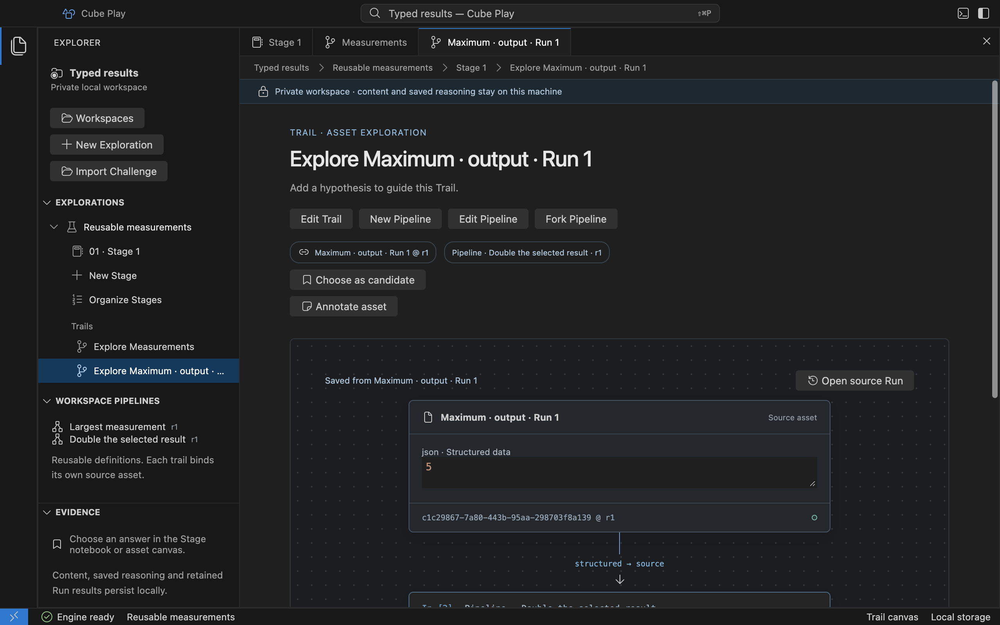

# Saved Pipelines and Trail configuration

A native Pipeline revision freezes a reusable operation definition. A Trail owns
its hypothesis, exact source Asset binding and selected Pipeline revision inside
one Exploration. [Explorations and Trails](../explorations.md#private-retention-consent)
shows the editing workflow.

The editor supports a typed graph with up to four named Asset inputs, up to eight
nodes and one selected output node. The engine discovers executable operations
from the Core registry, validates the whole graph and plans the chosen output's
ancestor closure. One bounded worker executes up to two dependency-ready nodes concurrently, sharing
the Run resource limits. See [parallel branches](desktop-runs.md#bounded-parallel-branches)
for grouping, join and failure behavior.
Runs share the [bounded Exploration queue](desktop-runs.md#concurrent-runs-and-queue).
Output caching remains a separate delivery. The [external terminal connection](../terminal.md#use-an-external-terminal)
uses this same coordinator with a fixed, explicitly issued context.

## Execution capabilities

Core owns executable registration beside each operation's descriptor and typed
contract. The native engine admits only data registrations whose input/output
representations, declared effects and retention policy it supports. Pure operations
and explicit monotonic-clock measurements need no file or network authority.
Discovery identifies unavailable capabilities and disables their selection with
an explanation. Supported private-data operations additionally require explicit
[local retention consent](../explorations.md#private-retention-consent) on each
saved node; capability discovery alone does not authorize retention. A CLI command or linear Core Pipeline
adapter alone grants no native execution.

The host handles text, lossless Base64 bytes, byte arrays, structured JSON and
materialized images. Generated image outputs render beside their producing cell
and can be saved as image Blocks with their exact Run, node attempt and port.
The existing Core PNG codec supplies the preview and Asset storage format;
encoding a preview creates no Pipeline attempt. Palette, transparency and source
sample values remain intact when the Asset feeds another operation.
New registrations using supported capabilities appear in operation
selection without a Play ID list, new dispatcher branch or operation-specific form.
New representations or permissions require explicit host work. Algorithms remain
in Core; schema/default discovery never executes them.

Parameter controls follow the full executable contract: enum choices retain their
actual string/number values, optional values can be omitted, and ordered arrays
use explicit JSON. The engine revalidates the complete schema and budget on save
and invocation. Invalid drafts cannot save a graph. **Advanced parameters** exposes
the same values, rather than an alternate execution path.

Image pixel export retains both `output` (`image.pixel_data` metadata) and `data`
(bytes). Choose the `data` port to decode UTF-8. Clockwise/counterclockwise spirals,
starting corner, reversal, region and channel selection belong to this operation's
Core parameters. See [read an image in a spiral](../explorations.md#read-an-image-in-a-spiral).

## Closed commands

All mutations carry an intent `key`. Workspace operations require
`workspace_id`; Trail operations require the full owning `context`.

| Command | Additional fields | Result |
| --- | --- | --- |
| `create_pipeline` | `title`, `definition` | `pipelineId`, `revision: 1` |
| `revise_pipeline` | `pipeline_id`, `expected_revision`, `definition` | The same ID and a new revision, or the current revision for an identical definition. |
| `fork_pipeline` | `pipeline_id`, `revision`, `title` | A distinct Pipeline at revision 1, with the exact source revision recorded. |
| `get_pipeline` | `pipeline_id`, `revision` | That exact selectable definition, available revisions and optional fork origin. No mutation key. |
| `save_trail` | `trail_id`, `expected_revision`, `hypothesis`, `pipeline`, `bindings` | `trailId` and the advanced Trail revision. |

A selected `pipeline` is `{ id, revision }` or explicit `null`. Revisions are
positive integers. A stale Pipeline head or Trail revision returns
`state_conflict`; saving a fork never edits its source. Receipts make matching
mutation retries idempotent. Reusing an intent with changed content returns
`idempotency_conflict`.

The engine rejects foreign owners, missing revisions, incompatible Asset types,
unsupported native adapters, wrong operation versions and invalid parameters
before committing anything. Archived sources cannot change Trail configuration.
Text/caption edits advance their primary Trail revision. Additional input bindings
remain pinned until an explicit Trail edit selects another Asset revision.

## Asset bindings

`source` is the first input and always resolves to the Trail's primary Asset.
Additional input names match `[a-z][a-z0-9_]{0,31}` and are unique. Each declares
an installed Core semantic type with an unambiguous physical representation.
Text and inert Page Assets satisfy text representations; images satisfy logical
image representations; immutable File revisions provide exact Base64 bytes or
numeric byte arrays, including file-source and byte-reader ports. The type choices
come from Core capabilities, without operation-ID branches.
Notes are evidence rather than executable inputs. Text and byte inputs share the
8,192-byte decoded Run budget; image bytes have their separate ceiling.

`save_trail.bindings` is a complete map of additional slot names to
`{asset_id, revision}`. Every extra slot needs a reference. The reserved source
cannot be overridden; a null Pipeline requires an empty map. The engine validates
same-Exploration ownership, active same-Stage membership, exact stored revision
and semantic type atomically with the Trail's expected revision. Asset IDs belong
to this map, never the reusable definition.

An older revision remains selectable while its Asset belongs to an active Block.
Editing the current caption does not silently retarget a pinned extra input.
Duplicating a figure remaps a binding to the copied Asset only when it names the
exact revision being copied; older pins retain their original reference.

## Definitions and execution

Definition format 4 contains named `inputs: [{name, semanticType}]`, a `nodes`
array and the selected `output` node UUID. Each node has a stable `id`,
`operation`, `operationVersion`, complete `parameters`, a bounded `position`
(`x`, `y`) and named `inputs`. A binding is exactly one of:

- `{kind: "input", name}` for one declared Trail input.
- `{kind: "output", nodeId, port}` for another node's named output.
- `{kind: "literal", value}` for an explicit Core-compatible value.

The engine rejects duplicate/missing node IDs, missing/extra ports, cycles,
unknown source slots, incompatible semantic types and unsupported versions before
saving. Consumers validate resolved values against their full Core schema before
execution. Matching semantic types do not bypass stricter value constraints.
There is no implicit connection conversion: a `bytes.array` input accepts an
explicit numeric byte-array literal or a File Asset viewed as that declared type.
Pixel and Brainfuck byte outputs use Core `bytes` objects; connecting those output
ports directly to `bytes.array` is rejected.
Text literals and byte arrays belong to the saved definition, so they must not
contain credentials or other secrets.

UTF-8 decoding consumes a Core `bytes` value and returns text without replacement;
encoding performs the reverse conversion. `text.concat` has required `left` and
`right` text ports and an optional `separator` defaulting to empty text.
`bytes.concat` joins required left/right Core byte values without an implicit
separator. The editor offers explicit Base64 literals for `bytes`; numeric byte
arrays retain their separate `bytes.array` representation. File Assets provide
the selected lossless byte representation from their full stored revision, never
from the preview.
The engine validates canonical Base64 and the combined decoded input budget
before admitting the Run.

The JSON adapters parse a text document, select a field by JSON Pointer and
extract an actual string explicitly. Numeric adapters parse canonical integer
text, compute a nonempty integer-array maximum and add named operands.
`image.dimensions` produces `{"dimensions":[width,height]}` in pixels. These
outputs use semantic type `json`; consumers still enforce their complete value
schemas. Integer operations use the shared exact ±9,007,199,254,740,991 range
and reject floating representations. See [Core field composition](https://github.com/cubearc/cube/blob/main/docs/reference/structured-composition.md).

Native composition inputs, including field paths, the text separator and repeated operands,
share the existing **8192-byte** per-node input ceiling. Aggregate raw output across
all executed nodes remains **16384 bytes**. Core's broader direct-call limits do
not enlarge these native budgets. See [ordered Core composition](https://github.com/cubearc/cube/blob/main/docs/reference/composition.md)
for exact empty/Unicode/binary semantics.

A fork preserves the chosen graph and records its immutable Workspace-scoped
origin. Revisions preserve node IDs unless the editor deliberately removes/adds
a node. Layout belongs to the revision. Definitions do not embed Exploration
Asset IDs, hypotheses or output values.

Trails keep their selected revisions when a Pipeline head advances. New text and
image Assets bind an existing matching default definition, or create that default
explicitly as part of the Asset transaction. A changed head cannot change the
default operation for a later Asset. Current revision reads resolve the selected
revision rather than assuming every Trail uses the latest head.

A Run requires the Trail revision, selected Pipeline ID/revision, source ID/revision
and explicit `target_node_id`. Its operation/version must match that target.
Choosing a node does not change the definition's default output.
A mismatch returns `pipeline_mismatch`. The saved plan freezes the Pipeline,
parameters and Trail hypothesis/revision at admission. Earlier Runs remain
unchanged when the working hypothesis, Pipeline or Asset changes.

The signed worker executes the saved parameters through Core. Image reads accept
`x`, `y` and `expand_palette`; coordinates are checked against the authorized image
before admission. Brainfuck exposes Core cell width, EOF policy and limit fields. Its instruction,
memory and output values cannot exceed the native ceilings. ROT13 accepts an empty parameter object.
The editor cannot raise worker CPU, time, memory or output ceilings.

## Limits and storage

| Limit | Maximum |
| --- | --- |
| Pipelines per Workspace | 32 |
| Selectable format-4 revisions per Pipeline | 32 |
| Named inputs | 4, including reserved `source` |
| Nodes / serialized definition | 8 / 8192 UTF-8 bytes |
| One literal | 2048 serialized UTF-8 bytes |
| Canvas coordinates | Integers from 0 to 4096 |
| Serialized parameter object | 2048 UTF-8 bytes |
| Trail hypothesis | 2048 UTF-8 bytes |
| Pipeline title | 120 UTF-8 bytes, nonempty |

Hypotheses count toward the 4 MiB Exploration payload ceiling. Definitions remain
subject to SQLite's 16 MiB page ceiling. Reaching a limit rejects the mutation;
finished evidence is never evicted to admit work.

[Schema 11](desktop-storage.md#single-baseline-and-refusal) appends executable
graph revisions for recognized earlier native definitions, preserving selected
configurations, IDs, historical rows and accepted Run snapshots. Only format-4
definitions are selectable/executable; historical formats remain immutable
evidence. The command boundary accepts only complete `definition` payloads.

## Structured content as a Pipeline input

Use **Add data** in a Stage notebook to create a typed JSON Asset. Choose its
Core data type and enter a value; invalid JSON remains a draft in the dialog.
Open the Asset canvas and choose a compatible operation for a saved Pipeline.
The receiver checks its complete contract before Run admission.

**Save as block** preserves a retained structured output's exact value, semantic
type and producing Run/attempt/port. The saved Asset can feed another Pipeline
without copying JSON into a literal. JSON-looking file or text content remains
file or text content until an explicit Core operation converts it.

The native workbench keeps the source Run link beside the saved Asset. The new
Pipeline consumes that exact revision; it does not relabel the source attempt.

### Puzzle-code values and ambiguity

Numbered Key, Headlines, Key Phrase, paginated Arnold word codes, the finite
Gajewski Solresol lexicon and explicit numeric puzzle profiles use the installed
Core contracts and native executors. Select the exact profile and required
parameters from that contract. Named token arrays and structured reports remain
typed JSON; text that resembles an array is not automatically converted.

Key Phrase decoding can return multiple candidate letters and nullable text.
Inspect its ordered readings; the nullable JSON output cannot silently connect
to a required text port. Prime-product decoding returns multiplicities and text
in alphabet order, which cannot recover the original letter order. Save the
structured report to preserve those distinctions and its definition identity.
Triliteral token output can connect directly to the matching token input without
joining strings or dropping leading zero trits. Native runs retain the exact
contract, parameters, named values and immutable evidence as for other operations.
