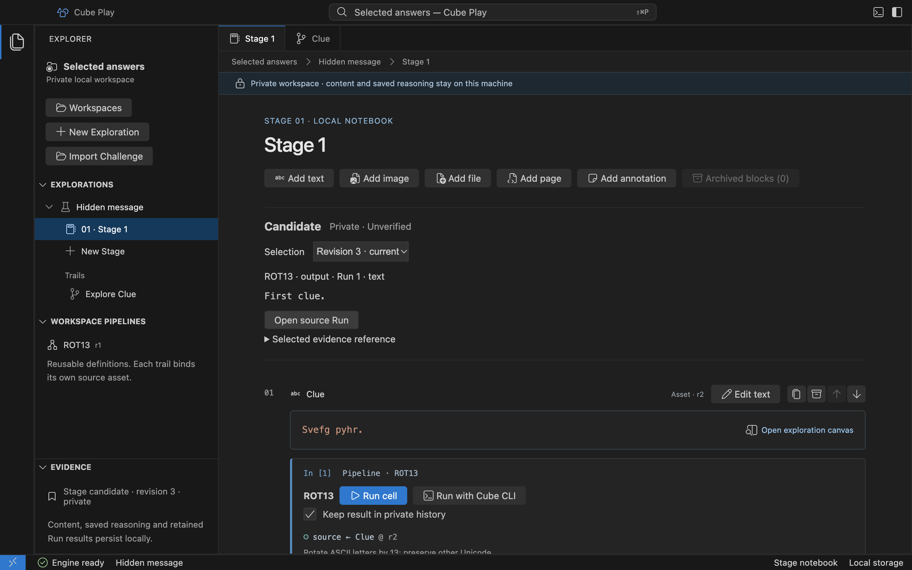
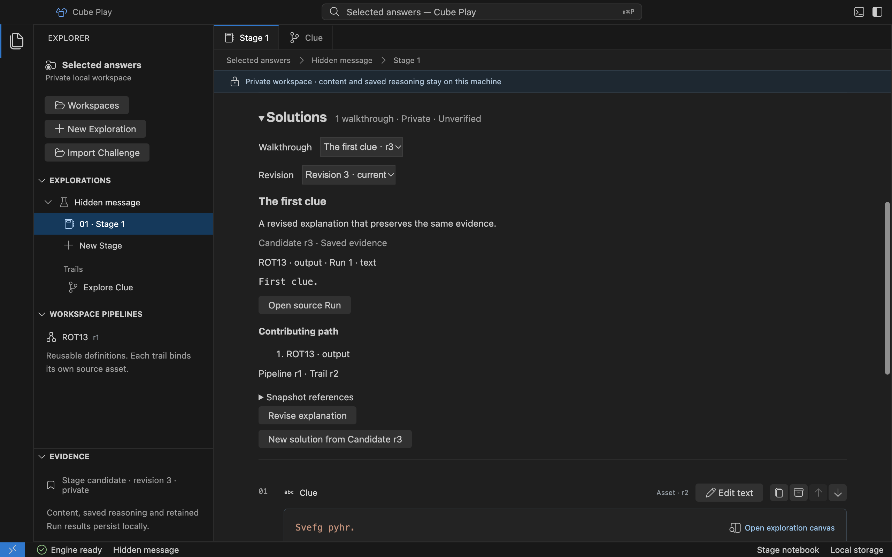

# Candidates and Solutions

Choose a private answer for a local Stage without changing the evidence that
produced it. A **Candidate** records an exact Asset revision or a named output
from a completed, retained Run. Later edits and executions leave that selection
intact. A **Solution** saves an explanation and the selected evidence as an immutable
walkthrough revision.

## Choose an answer

1. Open an Asset canvas and choose **Choose as candidate**, or run a notebook
   cell and choose **Choose as candidate** beside its output.
2. Open the Stage notebook. **Candidate** shows the selected content and its
   origin, marked **Private · Unverified**.
3. Choose another answer when your investigation changes. Use **Selection** to
   inspect an earlier Candidate revision. Looking at history does not replace
   the current answer.
4. For a selected Run output, choose **Open source Run** to inspect the original
   inputs, Pipeline revision and node attempts.

For example, select `Gur xrl.` as a Candidate, edit its working Asset to
`Svefg pyhr.`, and run **ROT13**. The first Candidate still contains `Gur xrl.`;
selecting the Run output creates another Candidate revision containing
`First clue.`. Both remain available after reopening the workspace.

An image and its caption remain grouped in the notebook. Open the image or
caption canvas to choose that specific Asset. Selecting a file preserves its
bytes; the Candidate panel labels its displayed text or hex as a preview.

## Evidence and limits

Each Stage has one Candidate with up to 32 immutable selections. Different
Stages and Explorations keep separate histories, including independent imports
of the same Challenge. Editing or archiving a Block does not replace a selected
Asset revision. No Candidate revision is overwritten or silently deleted.

Run selections retain their named output type, including numbers and structured
values. Play does not convert them to text implicitly. Use explicit Pipeline
operations to select a field, convert a value or combine results before choosing
an answer. Outputs that were not retained cannot become Candidates. Unavailable
evidence is shown as a gap while preserving its selected reference.

If another action changes the Candidate first, Play reloads its current revision
and asks you to review and choose again. It never silently replaces that newer
selection. Repeating an accepted request does not create another revision.

## Save a Solution walkthrough

1. Select the Candidate revision you want to explain in the Stage notebook.
2. Expand **Solutions** and choose **New solution from Candidate r…**. Confirm the
   displayed Candidate revision, enter a title and explain your reasoning.
3. Choose **Save solution**. The saved walkthrough shows your explanation, exact
   selected evidence and, for a Run output, its contributing operations.
4. Choose **Revise explanation** to append another revision. Earlier revisions
   remain available through **Revision**; the selected Candidate stays pinned.
   Choose **New solution from Candidate r…** to save a separate walkthrough.

A Run-output snapshot includes only the chosen node and its dependencies, the
used input revisions, operation configuration and exact Trail/Pipeline/Run and
attempt identities. Selecting an intermediate output excludes downstream nodes.
Unused alternatives remain available in their Trails and full Run history.
**Open source Run** opens that full historical Run for inspection.

An Asset selection preserves its exact revision and recorded origin. Play does
not infer a pipeline path from that Asset or recursively expand its origin chain.
To include the producing pipeline path, choose the retained Run output itself.

Each Stage can save 16 Solutions, each with 16 immutable revisions. Titles allow
120 UTF-8 bytes and explanations 2048 bytes. A conflict preserves your draft and
shows the saved revision for review before another save. Drafts survive switching
between that Stage's notebook and canvases; save before leaving the Stage or app.
Unavailable input, contract or output evidence appears as a gap. Availability
checks do not run the pipeline again or establish that an answer is correct.

## Official outcomes

Walkthrough export, additional note-target selection and recursive evidence
composition across Runs are not available in this preview.

Candidates and Solutions are private and unverified. Neither a successful Run, an integrity
hash nor available evidence establishes that a Challenge answer is correct.
Official submission, evaluation and publication belong to the separate Cloud
project and are not performed by **Choose as candidate** or **Save solution**.

The [storage reference](reference/desktop-storage.md#stage-candidates) documents
exact ownership, revision and IPC rules. Use [Run history](reference/desktop-runs.md)
to inspect execution evidence and [the notebook](notebook.md) to keep reasoning.
The remaining note/evidence workflow and old runtime retirement are tracked in
[#50](https://github.com/cubearc/play/issues/50).
