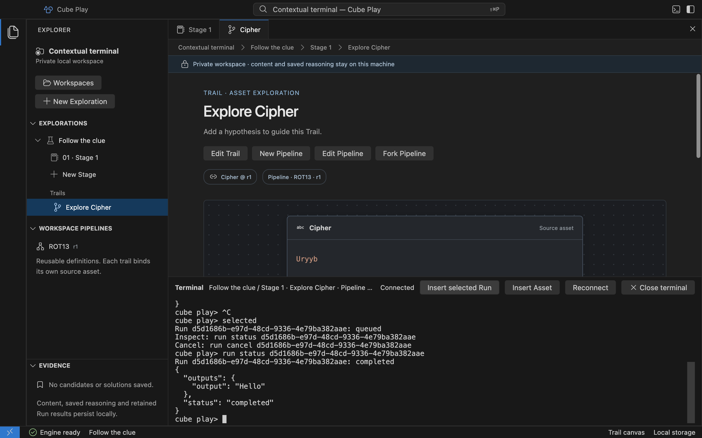

# Use the Cube terminal

<a id="isolated-cube-terminal"></a>
<a id="private-transport-and-browser-access"></a>
<a id="send-a-computed-result-to-the-lab"></a>
<a id="session-and-resource-boundaries"></a>
<a id="working-directories"></a>

The macOS and Linux Electron preview includes a native terminal using Cube
CLI contextual commands. It reads Stage Assets and runs a selected Pipeline through the same Rust
coordinator used by **Run cell**. Results remain beside their producing cell and
in Run history.

## Run the selected Pipeline

1. Open an Asset's Trail canvas and choose **Toggle Cube terminal** in the title
   bar or Command Palette. Ctrl+Backquote toggles the panel.
2. Check the terminal header: it pins the Exploration, Stage, Trail and Pipeline
   and source Asset revisions from when the session opened.
3. Choose **Insert selected Run**. This inserts `selected`; press Enter to execute.
4. The terminal prints the accepted Run ID and its current state. Type
   `run status ID` with that ID to inspect its recorded result. The cell also
   updates with the result and **Started by: Cube CLI** evidence.



Each `selected` command creates a separate Run from the pinned selection. Moving
to another Trail does not silently retarget the open terminal. Choose **Reconnect**
to bind the current selection; changing Exploration or Stage opens a fresh session.
A session opened from the notebook without a Trail still supports scoped reads.

## Inspect content and stop work

**Insert Asset** prepares a command for the selected source revision. Press Enter
to inspect it. Type `help` for these contextual commands:

```text
asset show ID --revision N
pipeline show ID --revision N
run status ID
run cancel ID
```

Replace IDs with the relevant local identities. Asset reads stay inside the
attached Stage; Pipeline reads use exact Workspace revisions. `size` reports
actual PTY columns and rows, including after resizing the window. `exit` or
**Close terminal** ends the session.

Ctrl+C clears the input draft. To cancel accepted work, use `run cancel ID` or the
cell's cancellation action. Closing the terminal does not cancel a Run; the engine
continues supervising it. Explicit application Quit still ends active work under
the application's lifecycle policy.

## Session boundaries

The panel accepts Cube contextual commands, not a system shell: pipes,
redirections, substitutions and arbitrary programs are unavailable. The CLI never
reads the private database or receives source paths. Run execution remains in the
restricted operation worker, using Core's registered contracts rather than a
terminal-specific operation list.

The transcript is temporary and is not saved as investigation evidence. Saved
Runs retain their chosen evidence independently. Reconnect after the five-minute
session limit or 64 entered lines; input/output budgets also close an exhausted
session. A disconnected renderer loses its terminal after ten seconds. Large
replies show a truncation notice; inspect the saved Run in Play for retained data.
The [runtime reference](reference/desktop-runtime.md#interactive-native-pty)
contains exact limits and transport details.

Native PTY execution requires macOS or Linux with Landlock and seccomp. Windows enforcement,
external terminal attachment and release packaging remain in
[#48](https://github.com/cubearc/play/issues/48) and the platform tasks. The separate
[Run with Cube CLI](explorations.md#run-a-cell-with-cube-cli) action remains available
for a single attached command.
