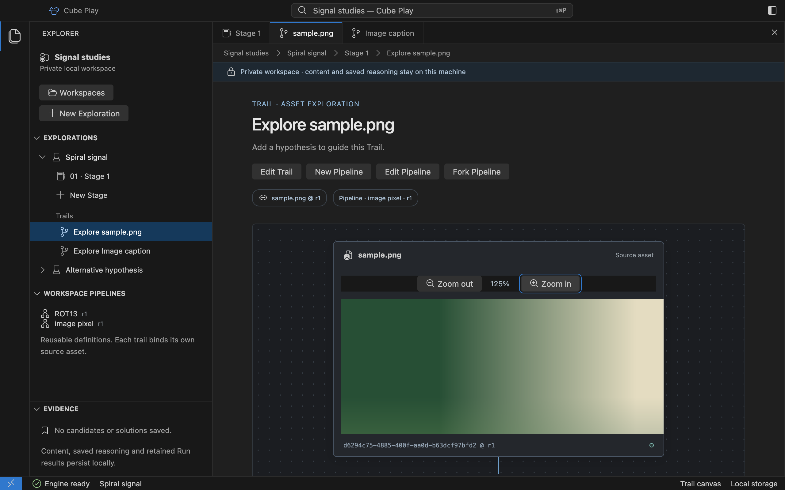
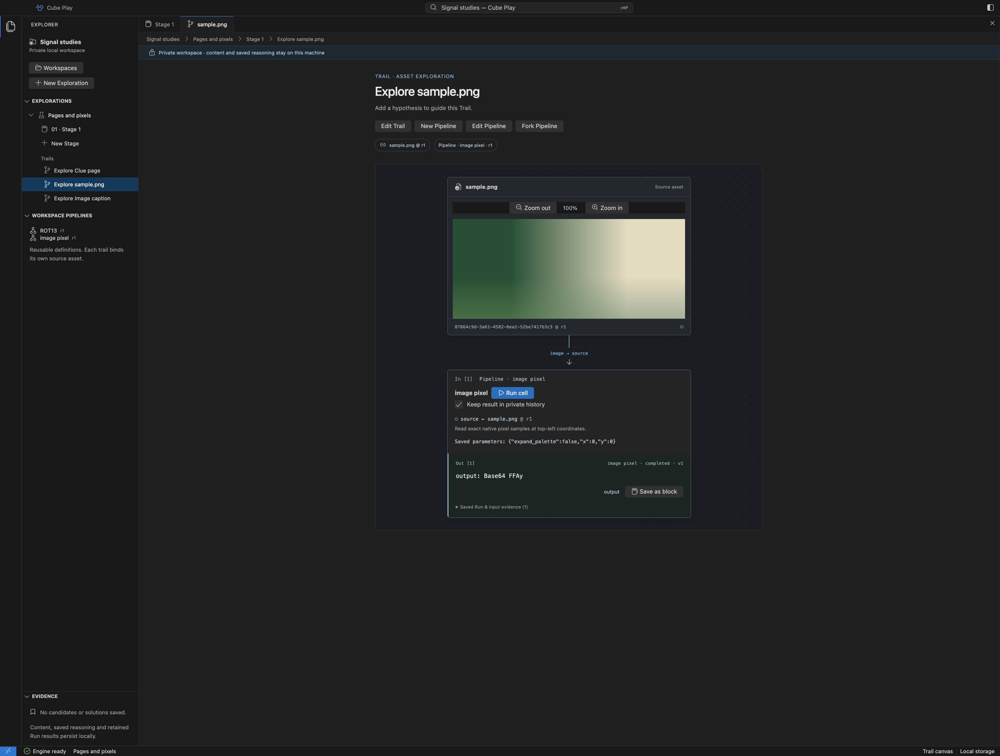

# Inspect an image in its canvas

[Add a PNG with its caption](workspace.md), then click the image in the Stage
notebook. Its Trail canvas opens in the same Exploration and shows the imported
image with zoom controls and a compatible operation. The original source file stays unchanged.

The image opens in a separate canvas with zoom and its native operation controls. [Open full size](assets/desktop/image-canvas.png).

## Read the first pixel

Open the image's canvas and choose **Run cell** on macOS. The native
`image.pixels.read` adapter reads the pixel at top-left coordinates `x: 0`,
`y: 0`, with palette expansion disabled. The canvas displays these saved
parameters. Choose **Edit Pipeline** to change `x`, `y` or `expand_palette`, then
**Save revision** and **Run cell**. Out-of-bounds coordinates are rejected before
execution. Other Trails keep their selected revision.
Core supplies the operation name, contract, decoding and sample-reading algorithm.

The result is bytes displayed as Base64, without an implicit text conversion.
For the repository's `tests/fixtures/sample.png`, Core returns RGB samples
`[20, 80, 50]`, displayed as `FFAy`. Use **Save as block** to preserve those exact
bytes as a File result. The Run pins the selected image Asset and revision;
its retained result reopens with the canvas and survives archiving the source.
An archived image cannot start another Run until restored.

The image operation records its own Run, independently of the caption. [Open full size](assets/desktop/image-operation.png).

For the same fixture, save a revision with `x: 1`, `y: 0` and
`expand_palette: false`, then run it. The bytes are `[230, 220, 190]`, displayed
as `5ty+`. The preceding Run keeps `FFAy` and is labeled as an earlier Pipeline
revision when selected.

Only installed compatible native adapters appear for each source. Image input is
validated as `image.samples`; ROT13 and Brainfuck require text. The engine also
rejects incompatible requests independently of the selector. Windows/Linux refuse
worker execution until their native enforcement is validated.

Click the caption to open its own text canvas. Its ROT13 or Brainfuck operation
uses the caption Asset, not the image pixels. The caption still appears with the
image in the notebook.

This preview has no general image-operation editor, pixel-spiral pipeline,
artifact comparison or arbitrary media viewer. A Core catalog entry does not
establish a native Play adapter. The current native execution behavior is in
[PipelineRuns](reference/desktop-runs.md); the canonical graph model is defined
in [the domain contract](reference/desktop-domain.md).
