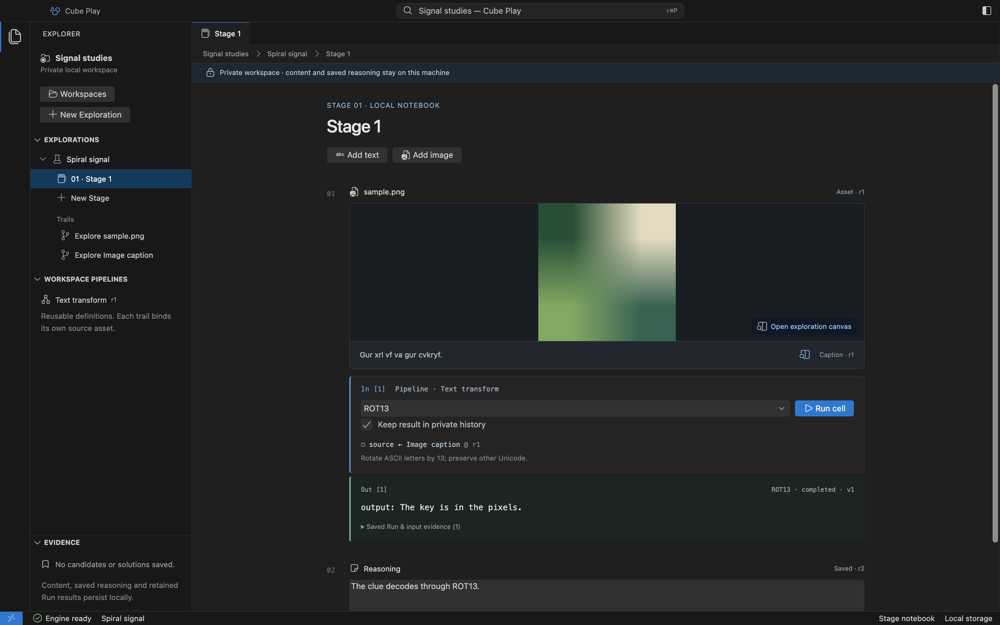

# Add text and image Assets

A Stage notebook holds ordered Blocks. Each text Block has a revisioned Asset.
An image Block holds the image and its caption together; the caption is a
separate text Asset within that same Block. Both can be opened in a Trail canvas.

## Add text

Choose **Add text**, enter a title and text, then choose **Add text** in the dialog.
The Block appears in the selected Stage. Its text can feed the native ROT13 or
Brainfuck adapter. The current ceiling is 1024 UTF-8 bytes per text Asset.

## Add an image with its caption

1. Choose **Add image** in the notebook.
2. Enter a caption, such as `Gur xrl vf va gur cvkryf.`.
3. Choose **Choose PNG** and select your own PNG, up to 128 KiB.

The image and caption render as one figure. Play copies the selected bytes into
its private store and validates them with Core; the original file is unchanged.
A cancelled chooser adds no Block. The import does not authorize sibling files
or turn the source folder into a browsable Workspace.

The image and its caption share one figure; ROT13 uses the caption Asset directly. [Open full size](assets/desktop/image-caption.png).

Click the image to open its inspection canvas, or the caption to open its text
Trail canvas. Running ROT13 below the caption transforms that caption's exact
Asset revision. It does not extract letters from the pixels. The image canvas
currently supports preview and zoom, rather than a full image operation graph.

## Limits and recovery

The preview accepts PNG image imports and text, rather than arbitrary files,
videos or executable pages. A Stage allows 8 Blocks including reasoning;
historical revisions and retained Runs also consume the Exploration's budget.
A rejected import preserves existing content and the source. Exact limits and
ownership rules are in [native storage](reference/desktop-storage.md).
