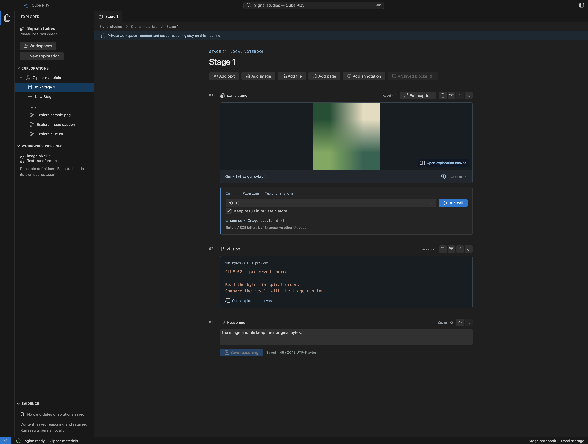
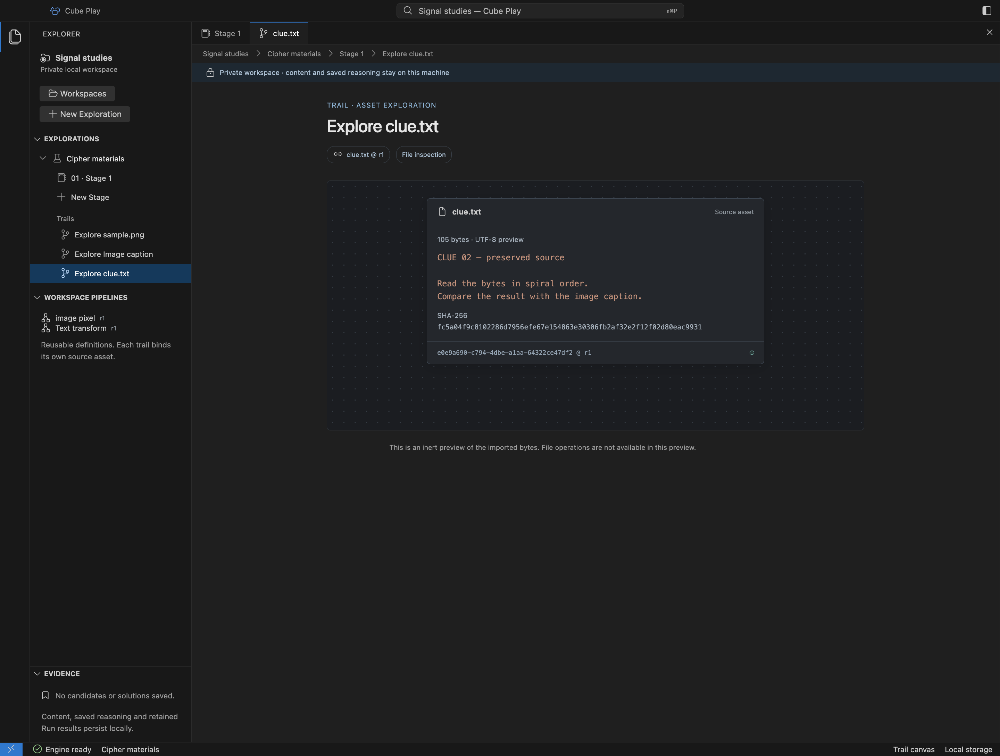

# Add text, image and file Assets

A Stage notebook holds ordered Blocks. Each text Block has a revisioned Asset.
An image Block holds the image and its caption together; the caption is a
separate text Asset within that same Block. Both can be opened in a Trail canvas.
Use the heading arrows to [reorder complete Blocks](notebook.md#reorder-the-notebook),
including reasoning, without changing their Assets or evidence.

## Add text

Choose **Add text**, enter a title and text, then choose **Add text** in the dialog.
The Block appears in the selected Stage. Its text can feed the native ROT13 or
Brainfuck adapter. The current ceiling is 1024 UTF-8 bytes per text Asset.

## Add an image with its caption

1. Choose **Add image** in the notebook.
2. Enter a caption, such as `Gur xrl vf va gur cvkryf.`.
3. Choose **Choose PNG** and select your own PNG, up to 128 KiB.

The image and caption render as one figure. Play copies the selected bytes into
its private store and validates them with Core; the original file is unchanged.
A cancelled chooser adds no Block. The import does not authorize sibling files
or turn the source folder into a browsable Workspace.

The image and its caption share one figure; ROT13 uses the caption Asset directly. [Open full size](assets/desktop/image-caption.png).

Click the image to open its inspection canvas, or the caption to open its text
Trail canvas. Running ROT13 below the caption transforms that caption's exact
Asset revision. It does not extract letters from the pixels. The image canvas
supports preview, zoom and a [native first-pixel Run](visual-lab.md#read-the-first-pixel).

## Edit saved content

Use **Edit text** for a text Block or **Edit caption** for an image's existing
caption. [Notebook editing](notebook.md#edit-text-and-captions) covers saving,
revision conflicts, keyboard controls and results from an earlier input. A caption
edit keeps the same figure and does not change the imported PNG.
To try a variation, [duplicate the Block](notebook.md#duplicate-a-clue) first.
The image and caption get independent Asset identities while preserving their
exact source revisions; editing the copied caption leaves the original alone.

## Add a file

Choose **Add file** and select your own regular file, up to 128 KiB. Play copies
its exact bytes into the selected Exploration, leaving the source unchanged.
Cancelling the chooser adds nothing. Only the filename is retained; importing
does not grant access to the source folder or adjacent files.

The Block shows the byte count and a short preview. Readable UTF-8 appears as
text; binary or control-containing content appears as hexadecimal. A **Partial
preview** label means more bytes were imported than are displayed. Click the
file to open its Trail canvas and inspect the preview and SHA-256 digest.

Files sit beside other notebook content and open their own canvas. [Open full size](assets/desktop/file-notebook.png).

The canvas identifies the preserved file content. [Open full size](assets/desktop/file-canvas.png).

HTML, scripts and links remain plain content; they never open a page, run a
program or fetch remote content. File operations and editing are not available
in this preview. Text imported as a file remains a File Asset and does not
silently become a runnable text cell.

Use the heading controls to [reorder](notebook.md#reorder-the-notebook),
[duplicate](notebook.md#duplicate-a-clue), or
[archive and restore](notebook.md#archive-and-restore-a-block) a file Block. A copy
has its own Asset and Trail, with the exact source revision recorded. The
original bytes, identities and order survive reopening.

## Limits and recovery

The preview accepts text, PNG images, bounded inert files and [Page source](notebook.md#add-an-inert-page). Video playback and
executable pages are not available. A Stage allows 8 active and 16 retained Blocks,
including reasoning. [Archiving](notebook.md#archive-and-restore-a-block) frees
an active slot while retaining content and evidence;
historical revisions and retained Runs also consume the Exploration's budget.
A rejected import preserves existing content and the source. Exact limits and
ownership rules are in [native storage](reference/desktop-storage.md).
